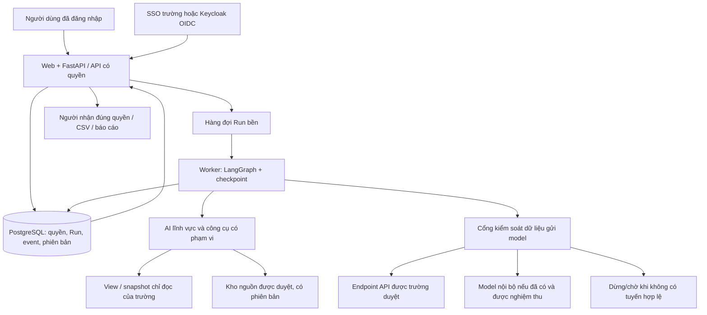

# Credere — kế hoạch đưa vào sử dụng thật tại nhà trường

**Bản lập ngày 13/10/2026.** Căn cứ chính là mã nguồn, dữ liệu đang nạp, bộ kiểm thử, các hồ sơ chạy/đo tốc độ đã lưu và lần kiểm tra kết nối hôm nay. Sơ đồ tiến độ và slide chỉ dùng để hiểu mục tiêu, không dùng thay bằng chứng triển khai.

**Quyết định đề xuất:** giữ lõi điều phối đã có, xây nền tảng quyền–dữ liệu–vận hành bền trước; mở pilot có người duyệt cho Tuyển sinh/Đào tạo và báo cáo Tổng hợp; làm NCKH/HTQT song song để đáp ứng đề bài gốc; mở Nhân sự/Hành chính từng nghiệp vụ sau khi vượt các cổng nghiệm thu. Không coi việc đổi tệp SQLite hay upload toàn bộ dữ liệu lên VPS là đã đủ điều kiện dùng thật.

Tài liệu này là kế hoạch, chưa phải triển khai các tính năng mới hoặc xác nhận Nhà trường đã cấp quyền dữ liệu. Lượt rà soát kiểm tra kết nối tới VPS và chạy test cục bộ; do SSH bị từ chối nên chưa đọc được tình trạng bên trong VPS hôm nay. Không sửa dịch vụ online hoặc gọi model tính phí.

## 1. Hiện trạng được kiểm tra lại

| Phần | Bằng chứng 13/10/2026 hoặc nguồn lịch sử | Kết luận |
| --- | --- | --- |
| Lõi điều phối | LangGraph, kiểm kế hoạch, phụ thuộc, chạy song song, review/sửa và tổng hợp có trong code | Tái sử dụng, không cần viết lại toàn bộ |
| Trợ lý đang nạp | Tuyển sinh: 70 văn bản/19 truy vấn; Đào tạo: 36/17; Tổng hợp: không có kho/DB trực tiếp, gọi hai AI con | Đã có bản thử của hai lĩnh vực và điều phối liên phòng |
| Dữ liệu nghiệp vụ | Hai SQLite đều `synthetic=True`, thời điểm ghi 17:00 ngày 18/08/2026 | Chưa có bằng chứng kết nối SIS/tuyển sinh thật |
| Kiểm thử phần mềm | Chạy lại: **159 passed, 45,06 giây** | Kiểm cơ chế; không chứng minh độ đúng mọi báo cáo hoặc an toàn production |
| Danh tính/quyền | Chỉ trang/API cấu hình có mật khẩu; `/api/ask` không có danh tính nghiệp vụ | Chặn mở dữ liệu nội bộ thật cho đến khi bổ sung |
| Run bền | `g.compile()` chưa có checkpointer; web dùng daemon thread | Chưa có resume sau crash, hủy thật hoặc hàng đợi bền |
| Lưu lịch sử | JSON theo app + câu hỏi chuẩn hóa/cắt 120 ký tự; có tự phát lại khi lỗi API | Không phù hợp lịch sử cá nhân hoặc dữ liệu luôn cập nhật |
| Nguồn | JSON/BM25 theo tài liệu; quyền thiếu mặc định `public` | Cần manifest được duyệt, vị trí bằng chứng và hiệu lực |
| Triển khai hôm nay | DNS vẫn trỏ `103.252.137.144`; cổng 22/80/443 đều từ chối kết nối từ máy kiểm tra | **Chưa truy cập được bản online**; chưa xác định do VM, firewall, dịch vụ hay nhà cung cấp |
| Hạ tầng lịch sử | 29/9 đo 2 vCPU, ~2 GB RAM, 20 GB đĩa; CPU rảnh và web nhanh khi DNS đã cache | Chỉ là số đo cũ, không phải bảo đảm công suất hoặc hiện trạng hôm nay |
| Thời gian model | Bản ghi cũ có Run Tổng hợp 287 giây; A/B ngày 2/10: ProxyLLM nhanh hơn Luna ở bài nhỏ, Sol chậm hơn | Chưa có căn cứ đổi toàn gateway hoặc tăng VPS để chữa độ trễ model |
| Release | Không có `.git` tại thư mục dự án; phụ thuộc khai báo theo khoảng, chưa có release/lock kiểm soát đầy đủ | Cần quản lý mã nguồn và môi trường tái lập |

Lần kiểm tra thất bại hôm nay không đủ để kết luận VPS hết hạn hay mất dữ liệu. Phải kiểm tra bảng quản lý/VNC của nhà cung cấp rồi mới xác định nguyên nhân. Biên bản không có mật khẩu nằm ở `deployment_review_20261013.json`.

## 2. Đích đến toàn dự án và phạm vi dùng thật đầu tiên

### Đích đến

| Lĩnh vực | Công việc sản phẩm hoàn chỉnh sẽ hỗ trợ | Đầu mối nghiệp vụ cần cử |
| --- | --- | --- |
| Tuyển sinh | Quy định, tư vấn, hồ sơ, nguyện vọng, chỉ tiêu, trúng tuyển/xác nhận/nhập học, báo cáo mùa | Đơn vị phụ trách tuyển sinh |
| Đào tạo | Chương trình và chuẩn đầu ra; quy chế theo khóa; học vụ, tín chỉ, điểm, cảnh báo, lớp/thi | Đơn vị quản lý đào tạo + khoa/giảng viên được phân công |
| NCKH | Đề tài, công bố, định mức, tài trợ; so sánh case study, kế hoạch nghiên cứu và chi phí | Đơn vị quản lý khoa học; tài chính xác nhận định mức |
| HTQT | Đối tác, thỏa thuận, liên kết, học bổng, trao đổi và nghiên cứu quốc tế | Đơn vị phụ trách HTQT |
| Nhân sự | Chính sách, hợp đồng, nguồn lực, lương/KPI trong quyền được phê duyệt | Đơn vị tổ chức/nhân sự |
| Hành chính | Công văn, thủ tục, biểu mẫu, tài sản/cơ sở vật chất và dự thảo | Đơn vị hành chính và chủ quy trình |
| AI Tổng hợp | Chọn đúng lĩnh vực, giao việc và đối chiếu báo cáo liên phòng phục vụ người có quyền | Ban Giám hiệu/người được ủy quyền; không mặc định quyền mọi hồ sơ |

Đào tạo–NCKH–HTQT là ba Worker chuyên môn tối thiểu của `Bài toán.docx`/PLAN. Tuyển sinh đã được làm sớm để demo. Pilot TS/ĐT là cách đưa vào sử dụng sớm, **không thay thế hoặc hủy phạm vi NCKH/HTQT**, và không thu hẹp mục tiêu sáu lĩnh vực.

### Pilot đầu tiên: 5–10 cán bộ, 6–8 đầu việc đã chốt

Đề xuất một nhóm nhỏ gồm chuyên viên Tuyển sinh, Đào tạo và đại diện lãnh đạo; người phụ trách nhận xét hàng tuần. Không mặc định mở cho toàn bộ sinh viên/thí sinh ngay.

1. Tra quy chế/chương trình đúng khóa và phiên bản, mở được trang/mục nguồn.
2. Tổng hợp xác nhận nhập học/chỉ tiêu còn lại theo ngành trên snapshot đã duyệt.
3. Tổng hợp cảnh báo học vụ theo kỳ/ngành trên dữ liệu do trường xác nhận.
4. Đối chiếu hai lĩnh vực bằng mã ngành/khóa và mốc thời gian thống nhất.
5. Soạn nháp báo cáo hoặc thông báo từ nguồn được duyệt, cán bộ kiểm trước sử dụng.
6. Danh sách cần liên hệ hoặc theo dõi chỉ mở cho tài khoản được cấp quyền, bảng đi thẳng từ backend; thêm ở nấc pilot tiếp theo khi kiểm xuất dữ liệu đạt.

Đầu tiên có thể chạy công khai/không định danh đã được duyệt; “không định danh” phải được đánh giá nguy cơ suy ra người, không chỉ bỏ cột tên. Không tự quyết điểm chuẩn, tốt nghiệp, buộc thôi học, kỷ luật/nhân sự; chưa ghi ngược vào hệ thống trường hoặc tự gửi thông báo. Các tác vụ có ảnh hưởng phải có người duyệt cụ thể.

## 3. Thứ tự và điều kiện chuyển giai đoạn

Ước lượng dưới đây giả định **hai người phát triển làm việc tập trung**, một người kiểm thử bán thời gian, đầu mối CNTT và hai đầu mối nghiệp vụ có lịch phản hồi. Tính từ lúc có người và đầu vào, không coi thời gian chờ dữ liệu/phê duyệt là ngày công lập trình. Một người hoặc nhân sự không chuyên trách phải tính lại lịch.

| Giai đoạn | Thời gian dự kiến | Công việc và sản phẩm | Người chịu trách nhiệm | Điều kiện hoàn thành |
| --- | --- | --- | --- | --- |
| G0 — Khôi phục và chốt phạm vi | 2–5 ngày làm việc | Xác minh VPS, backup, release; chốt 6–8 use case, đầu mối, quyền dữ liệu và nhà cung cấp | Nhóm + CNTT + người bảo trợ | Có môi trường kiểm thử, danh mục đầu vào và người ký duyệt |
| G1 — Nền tảng an toàn/bền | Tuần 1–3 | Đăng nhập/quyền, PostgreSQL, Run ID, worker/hàng đợi, tắt replay production, secret/release | Backend + CNTT | Test cross-user/source/export; crash và retry cơ bản đạt trên dữ liệu giả lập |
| G2 — Nhận và chuẩn hóa dữ liệu | Tuần 2–5, song song G1 | Adapter TS/ĐT, quy tắc theo năm/khóa, phiên bản nguồn, bộ KPI đối soát | Data/backend + đơn vị sở hữu | KPI khớp báo cáo trường trên cùng snapshot; lỗi được xử lý/duyệt |
| G3 — Hoàn thiện chất lượng/tốc độ | Tuần 4–7 | Hợp đồng AI con, bằng chứng, query templates, đo đầy đủ latency/cost, thử provider/model | Nhóm + QA + chuyên viên | Đạt bộ phát triển, test quyền, lỗi, tải; đủ bằng chứng mở shadow |
| G4 — Chạy song song và pilot | Tuần 8–10; dự phòng tới 12 | Shadow 1–2 tuần rồi 5–10 người dùng thật, cán bộ duyệt và ghi lỗi | Nghiệp vụ + CNTT + nhóm | Qua các cổng ở mục 11; không còn lỗi nghiêm trọng mở |
| G5 — Bổ sung MVP học thuật | Thu nguồn từ tuần 1; xây/đo theo năng lực, khoảng tuần 6–14 | NCKH, HTQT, kịch bản ba case/lộ trình/chi phí; không cắt nguồn lực G1 | Đầu mối KH/HTQT + dev | Mỗi lĩnh vực có nguồn/quyền/đáp án và nghiệm thu riêng |
| G6 — Hoàn thiện sáu lĩnh vực | Sau pilot, lập lịch từng gói | Hành chính tra cứu/quy trình trước; Nhân sự theo quyền; liên lĩnh vực; self-service được duyệt | Nhà trường + nhóm vận hành | Phê duyệt phạm vi từng gói, bảo mật và tải đạt trước mở |

Mục tiêu thực tế là **pilot dữ liệu thật có kiểm soát khoảng 8–12 tuần** sau khi đủ đầu vào. Phạm vi sáu lĩnh vực và tích hợp sâu có thể cần nhiều tháng nữa; dự trù lập lịch tổng thể 4–6 tháng trở lên sau khảo sát, không cam kết toàn trường trong 12 tuần. Khung đề tài 10–12/2026 và phạm vi vận hành toàn trường là hai mốc nghiệm thu khác nhau.

## 4. Việc làm ngay: hạ tầng và quản lý release

### 4.1 Khôi phục đúng nguyên nhân

- Đầu mối giữ tài khoản VPS kiểm trạng thái VM, thanh toán/gia hạn, security group, firewall và console/VNC. Không reset/reinstall khi chưa chụp snapshot hoặc xác nhận backup.
- Nếu máy còn sống, kiểm SSH, Nginx, service Credere, dung lượng và log lỗi; nếu IP thay thì đối chiếu DNS trước thay cấu hình.
- Xác nhận lại HTTPS, `/api/apps`, nguồn và SSE; kiểm nội dung không chỉ HTTP 200. Không dùng một bản ghi thành công để báo đã nghiệm thu provider live.
- Khi không có backup máy, bản cục bộ là nguồn để dựng lại **demo**, chưa chứng minh phục hồi được dữ liệu/run phát sinh trên VPS sau lần copy.
- Chỉ đọc kiểm tra đã được làm trong lượt này. Không tự khôi phục, mua hay mở/khóa site khi người dùng chỉ yêu cầu kế hoạch.

### 4.2 Chuyển sang quyền quản lý của trường

- Tên miền, hosting, API project, billing, kho source và recovery contact do Nhà trường chỉ định người sở hữu, có người dự phòng. Domain demo có thể giữ riêng để trình diễn.
- Tạo ba cấu hình và kho dữ liệu tách biệt: dev/giả lập, staging kiểm thử, production/pilot. Không dùng chung key hoặc lịch sử.
- Đưa mã nguồn vào Git riêng; `.gitignore` bỏ `.env`, `vps.txt`, credential/hash, `.venv`, dataset nội bộ, logs, artifacts. Mật khẩu/khóa đã từng đi qua chat/file chia sẻ cần đổi ở bước chuyển giao, xác nhận xong mới thu hồi cái cũ để tránh mất quyền vận hành.
- Khóa dependency theo release, lưu schema migration, script build/deploy/rollback, inventory file có checksum, license/dependency bill of materials. Test release trên Linux như VPS.
- Không chuyển nguyên thư mục `tmp`, staging nguồn, backup cũ hay `vps.txt` vào production app. Sao lưu toàn bộ nếu được phép là một việc; gói runtime có manifest được kiểm tra là việc khác.
- Chạy app/worker bằng tài khoản dịch vụ tối thiểu, không mặc định root; CSDL/queue chỉ trong mạng nội bộ. Không dùng file cấu hình Nginx local cũ để ghi đè vì nó vẫn có Basic Auth đã bị gỡ trên VPS theo yêu cầu người dùng.

## 5. Kiến trúc pilot đề xuất: tận dụng phần đã viết

**Giữ:** FastAPI, LangGraph, Pydantic, registry AI con, truy vấn cố định và bộ tính an toàn. Giữ UI hiện có, sửa thành luồng có tài khoản, lịch sử Run, hủy và xem nguồn theo quyền. Chuyển React/assistant-ui không phải điều kiện mở pilot; không trì hoãn auth/dữ liệu để viết lại UI.

**Bổ sung:** PostgreSQL + migration cho người dùng/quyền/Run/events/artifacts/usage/data versions; persistent checkpointer cho graph; một hệ thống queue có retry/lease để chạy cả Run. Đề xuất spike FastAPI hiện có + Procrastinate/PostgreSQL trước, vì không cần đưa đồng thời Aegra và một scheduler thứ hai vào lõi. LangGraph vẫn là nơi quyết định Task/phụ thuộc. Chốt phương án sau thử crash, hủy, resume, quyền và bảo trì. Nếu Aegra giảm được công một cách đã kiểm chứng thì ghi quyết định thay thế, không vận hành hai bộ quản lý Run chồng nhau.

Checkpointer giúp giữ graph state nhưng không tự bảo đảm dịch vụ ngoài chỉ bị gọi một lần; cần idempotency, ghi attempt và đối soát trạng thái chưa rõ. Queue cũng không thay thế quyền hay kiểm dữ kiện. [LangGraph persistence](https://docs.langchain.com/oss/python/langgraph/persistence), [Procrastinate](https://procrastinate.readthedocs.io/en/stable/discussions.html).

**Sizing ban đầu để thử:** tận dụng hạ tầng trường; nếu cần máy mới cho API-mode, lấy 4 vCPU/8–16 GB RAM, SSD có backup làm mốc thử app+worker và PostgreSQL, không coi đây là cấu hình đã đủ mọi tải. Tách DB/worker khi đo thấy cần. Hạ tầng CPU này không chạy LLM lớn local. Không triển khai Kubernetes hoặc nhiều broker chỉ vì mục tiêu cuối có sáu AI; các AI có thể dùng chung model service.

### API/Run cần có

| API dự kiến | Yêu cầu |
| --- | --- |
| `POST /runs` | Danh tính từ session, body chứa câu hỏi; giới hạn/kiểm quyền trước planner; idempotency key |
| `GET /runs/{id}` | Chỉ chủ Run/người được chia sẻ; không tra theo slug câu hỏi |
| `GET /runs/{id}/events` | SSE có event ID, đọc tiếp; quyền kiểm lại khi nối lại/thu hồi |
| `POST /runs/{id}/cancel` | Chặn bước chưa gửi; đánh dấu rõ request ngoài có thể vẫn tính phí |
| `POST /runs/{id}/resume` | Kiểm quyền/phiên bản/chính sách lại; tránh hai executor điều hành |
| `GET /artifacts/{id}` | Kiểm người nhận + lineage nguồn; không phát file chung theo URL đoán được |
| `POST /exports` | Backend xuất đầy đủ theo quyền, phân trang, số lượng đối soát và audit |

Đổi khỏi `GET /api/ask?q=...` để câu hỏi nhạy cảm không nằm trong URL/proxy history. Không log body mặc định khi chuyển sang POST. Production không tự fallback sang replay theo câu hỏi; thông tin đã lưu chỉ mở như lịch sử có ngày/nguồn/phiên bản, phải kiểm lại quyền.

## 6. Cổng bảo mật thông minh phải trở thành code

### 6.1 Danh tính và quyền

Ưu tiên SSO có sẵn của trường; nếu chưa có, dùng nhà cung cấp OIDC được CNTT quản lý thay cho tự viết password/session cho mọi vai trò. MFA cho quản trị. Backend xác minh issuer/audience/chữ ký/hạn token; quyền truy cập được tra từ nguồn tin cậy, không từ lời nhắc hoặc tab được chọn. [Keycloak OIDC](https://www.keycloak.org/securing-apps/oidc-layers).

Ma trận quyền tối thiểu: người dùng → đơn vị → lớp/ngành/phạm vi → loại hồ sơ → hành động `read / aggregate / export / approve / administer`. Có quyền tổng hợp không mặc định được xem liên hệ hoặc lương từng người. Mã giảng viên do model điền không phải danh tính người dùng. SSO chỉ xác thực; backend kiểm quyền đối tượng trên mọi đường đọc. [OWASP Authorization](https://cheatsheetseries.owasp.org/cheatsheets/Authorization_Cheat_Sheet.html).

Nếu dùng PostgreSQL RLS, runtime không có superuser/BYPASSRLS; xử lý quyền chủ bảng, đặt ngữ cảnh trong transaction và reset khi trả connection pool. RLS là lớp bổ sung, không thay kiểm quyền file/export/model payload. [PostgreSQL RLS](https://www.postgresql.org/docs/current/ddl-rowsecurity.html).

### 6.2 Một phong bì quyền cho cả cây tác vụ

Backend gắn vào Run/Task: `principal_id`, `department_ids`, `allowed_actions`, `row_scopes`, `allowed_fields`, `purpose`, `source_versions`, `classification`, `allowed_model_routes`, `policy_version`, `expires_at`. AI con chỉ nhận tập quyền bằng hoặc hẹp hơn cha. Đây là dữ liệu được code thực thi, không chỉ prompt.

Sửa ngay `workers._run_subagent()` đang không chuyển `task.constraints`, reviewer chưa xét đầy đủ constraints; ngừng cắt JSON đầu vào liên phòng ở 6.000 ký tự. Giới hạn phải là chọn cột/dòng có kiểm chứng, tham chiếu artifact được phép hoặc hỏi lại, kèm dấu hiệu thiếu dữ liệu rõ ràng.

### 6.3 Quyết định gửi gì, tới đâu

1. Phân loại trước lời gọi đầu tiên, kể cả câu hỏi người dùng đã dán tên/điểm/lương vào. Nguồn thiếu metadata/quyền vào vùng chờ, không mặc định `public`.
2. Truy vấn dữ liệu theo quyền ngay trong hệ thống trường; thống kê/mẫu số tính bằng code/SQL đã duyệt.
3. API chỉ nhận payload tối thiểu được phép: nguồn công khai hoặc thống kê đã được đánh giá khả năng suy danh tính. Không gửi danh sách thật nếu tác vụ chỉ cần con số.
4. Khi phù hợp, dùng mã tạm có phạm vi từng Run; kho ánh xạ giữ nội bộ, có hạn lưu. Thay định danh không phải ẩn danh hoàn toàn; vẫn kiểm nhóm nhỏ, dữ liệu hiếm và nhiều truy vấn để suy ngược.
5. Nội dung local-only phải giữ nội bộ qua planner, worker, reviewer, AI Tổng hợp, retry và fallback. Chưa có model nội bộ được duyệt thì chặn/hỏi cách xử lý, không hạ chính sách vì cần chạy demo.
6. Kiểm output và quyền người nhận; chỉ ghép danh tính vào mẫu/schema đã duyệt tại backend. Không thực hiện lệnh truy vấn hoặc giải mã thêm do model sinh.
7. Log, lịch sử, báo cáo, cache và file xuất áp dụng cùng nhãn/lineage. Quyền nguồn bị thu hồi phải ảnh hưởng kết quả phát sinh.

Ví dụ nhắc nhập học: API soạn mẫu từ thời hạn công khai; trường truy vấn danh sách rồi điền tên/điện thoại cho cán bộ có quyền. Không tự gửi tin. Với hồ sơ nhân sự cần đọc nội dung hạn chế: xử lý toàn nhánh nội bộ hoặc dừng.

`trusted=true` hiện chỉ là nhãn quản trị tự đặt; không chứng minh provider đúng model, có hợp đồng hoặc được phép giữ dữ liệu. Cần danh mục endpoint do trường duyệt, model/version, khu vực xử lý, điều kiện lưu giữ/không huấn luyện, billing và cơ chế thu hồi. Với OpenAI API, không dùng để huấn luyện mặc định và thời hạn lưu/điều kiện ZDR là các vấn đề khác nhau; phải xét endpoint và điều kiện tài khoản. [OpenAI data controls](https://developers.openai.com/api/docs/guides/your-data).

Nội dung câu hỏi, file tải lên hoặc trang web là dữ liệu không đáng tin: kiểm thử prompt injection nhằm đổi quyền, đọc kho ánh xạ, gọi công cụ hoặc gửi dữ liệu sai tuyến. Khi bổ sung đọc web cho NCKH, fetcher chặn địa chỉ private/loopback/metadata, kiểm DNS và mọi redirect, giới hạn loại tệp/dung lượng/thời gian; nguồn đề xuất URL không được tự mở quyền truy cập mạng nội bộ. Mọi lượt gọi công cụ vẫn được policy gate kiểm độc lập với nội dung model.

### 6.4 Phê duyệt và vận hành dữ liệu

Đơn vị chủ dữ liệu cùng CNTT/bộ phận phụ trách bảo vệ dữ liệu xác định mục đích, phạm vi, căn cứ xử lý, bên nhận, quyền xuất, hạn lưu/xóa, trách nhiệm và nghĩa vụ áp dụng. Không coi một email đồng ý hoặc đã công bố trên web là kết luận tự động miễn mọi nghĩa vụ. Không suy từ việc dữ liệu đặt tại trường thành dữ liệu không rời trường.

Khóa bí mật trong kho secrets hoặc file quyền tối thiểu ngoài source; không nhập khóa qua màn hình chia sẻ. Xoay khóa có lịch/chủ sở hữu. Mã hóa khi truyền và lưu, backup khác nơi có quyền riêng, thử restore. Tách log kỹ thuật khỏi payload nhạy cảm; không lưu đầy đủ prompt/responses nếu không cần và chưa được duyệt. Đặt mức lưu cụ thể sau khi trường chốt, không giữ vĩnh viễn mặc định.

## 7. Hợp đồng dữ liệu trước khi kết nối

### 7.1 Mỗi tập dữ liệu cần một manifest được duyệt

`dataset_id`, `owner_unit`, `steward`, `approved_by`, `schema_version`, `source_system`, `record_key`, `snapshot_id`, `snapshot_at`, `effective_from/to`, `classification`, `allowed_roles/actions/fields`, `allowed_model_routes`, `retention_policy`, `quality_checks`, `checksum`, `status`.

Thêm cờ loại dữ liệu có cấu trúc (`synthetic / real-approved / quarantine`), không suy từ chữ “GIẢ LẬP” trong ghi chú. CSDL demo luôn ở namespace riêng; đổi chữ ghi chú không được tự mở tuyến gửi API. Manifest, dữ liệu và quyền phải đồng phiên bản.

### 7.2 Đầu vào cụ thể cần trường cung cấp

| Gói | Dữ liệu tối thiểu | Việc phải thống nhất |
| --- | --- | --- |
| Dùng chung | Mã đơn vị/ngành/chương trình/khóa/kỳ/năm/đợt; dictionary chỉ số; người dùng/quyền | Mã nguồn, timezone, null, thay đổi/xóa, nhiều lần ghi một người |
| Tuyển sinh | Ngành, chỉ tiêu, phương thức, điểm chuẩn theo mùa/đợt; nguyện vọng; trúng tuyển; xác nhận; nhập học; snapshot | Phân biệt người/nguyện vọng; trúng tuyển/xác nhận/nhập học; chỉ tiêu thiếu, đồng hạng |
| Đào tạo | Sinh viên và trạng thái theo ngày; chương trình/chuẩn đầu ra có phiên bản; môn/lớp/đăng ký/điểm; kết quả kỳ, cảnh báo, giảng viên–lớp | Quy chế áp dụng theo khóa, học lại/cải thiện/miễn/chuyển ngành; tử/mẫu số và làm tròn |
| Liên phòng | Mã xét tuyển ↔ ngành/chương trình; mã thí sinh ↔ sinh viên; khóa/năm và mốc chốt | Bảng ánh xạ cá nhân nằm nội bộ; tỷ lệ ghép, ngoại lệ và thời điểm nguồn |
| NCKH | Đề tài/công bố/DOI, năm, đơn vị, trạng thái, kinh phí được phép, định mức, cơ hội tài trợ | Chống đếm đôi công bố; định nghĩa kết quả; đơn giá và kỳ tham chiếu |
| HTQT | Đối tác, thỏa thuận, thời hạn, chương trình/học bổng/trao đổi và quy trình | Phân biệt thông tin công khai với điều khoản/hồ sơ hạn chế |
| Nhân sự | Chính sách công khai trước; hợp đồng/chức danh/đơn vị/lương/KPI chỉ theo nhu cầu được duyệt | Quyền rất cụ thể theo trường dữ liệu; người phê duyệt mọi đầu ra nhạy cảm |
| Hành chính | Quy trình, biểu mẫu, công văn, tài sản/phòng theo phiên bản | Ai chịu trách nhiệm nội dung và ai duyệt văn bản phát hành |

Đầu tiên xin snapshot/CSV/API chỉ đọc được nhà trường chuẩn bị, không xin quyền quản trị CSDL nguồn. Dùng tài khoản kỹ thuật tối thiểu và mạng/đường kết nối được CNTT cho phép. Không đổi schema/ghi dữ liệu vào SIS hoặc phần mềm tuyển sinh khi chưa có use case ghi và phê duyệt riêng.

### 7.3 Quy trình nhập và phát hành

Nhận dữ liệu → khu cách ly → kiểm manifest/schema/malware nếu có tệp → đối soát → chuẩn hóa → gắn quyền/phiên bản → chủ dữ liệu duyệt → publish snapshot → test hồi quy → phục vụ. Nếu lỗi, giữ phiên bản đã duyệt trước và báo độ cũ, không trộn nửa snapshot mới/nửa cũ. Có rollback, batch ID và báo cáo bản ghi bị loại; không im lặng bỏ hàng lỗi.

Các tổng pilot phải khớp **trên cùng kỳ, mẫu số và snapshot** với báo cáo chính thức hoặc chênh lệch được giải thích/duyệt. Dữ liệu giả lập Đào tạo hiện được sinh dựa vào Tuyển sinh để khớp tổng; tính chất đó không chứng minh adapter hai hệ thống thật sẽ khớp.

### 7.4 Sửa quy tắc đang gắn demo

- Bỏ hardcode 2026/2025, K10–K12, `LATEST=2025-2026-2` và ngày 17/8 ra khỏi logic chung. Danh mục thời gian và quy tắc theo chương trình/khóa/học phần/ngày hiệu lực do nghiệp vụ duyệt.
- Không áp công thức 40%–60%, sĩ số 70 hoặc chương trình rút gọn của dữ liệu giả lập cho trường thật. Cảnh báo/tốt nghiệp là rà soát hỗ trợ đến khi đủ quy tắc và người duyệt.
- Chặn `NaN/Inf`, khóa trùng, FK sai, mẫu số bằng 0 và đơn vị thiếu. Kết quả phân biệt số người duy nhất với số lượt/dòng.
- Schema TS cần khóa theo năm/đợt/phương thức, ĐT cần phiên bản chương trình/khóa áp dụng và lịch sử, không ép vào khóa demo chỉ có một mã người.
- Danh sách lớn phân trang tại DB; export server có kiểm quyền. Hiện UI lấy tối đa 1.000 dòng rồi tải CSV từ phần đó: phải xuất đủ hoặc ghi rõ giới hạn, đối soát tổng và xử lý ô có thể thành công thức Excel.
- Các điểm mâu thuẫn ở `DIEM_CHUA_THONG_NHAT*.md` là **vấn đề cần phòng chuyên môn xác nhận**, không dùng diễn giải của AI như kết luận hiệu lực văn bản.

## 8. Hoàn thiện nghiệp vụ và kiểm chứng báo cáo

### Hợp đồng Task/Result mới

Giữ `task_id/goal/context/constraints/depends_on`, bổ sung envelope quyền và `required_outputs`. Kết quả gồm `data`, `claims`, `evidence_refs`, `source_versions`, `query_id/params/snapshot`, `units`, `denominator_definition`, `completeness`, `assumptions`, `warnings`, `errors`, `review_status`.

Không mất assumptions khi tổng hợp, không coi một truy vấn thành công là cả nhiệm vụ đầy đủ khi các truy vấn khác lỗi. Không chặt chuỗi JSON để giảm prompt. AI con chỉ chuyển kết quả được phép lên cấp trên và mang theo trạng thái kiểm chứng/giới hạn.

### Kiểm bằng code trước, bằng chứng nội dung sau

- Số liệu lấy nguyên từ truy vấn/công thức có ID, code tính và kiểm đơn vị/mẫu số; bảng kết quả tốt nhất render từ artifact thay vì để model viết lại từng số.
- Claims tài liệu nối tới đoạn trích, trang/mục, phiên bản/hiệu lực, không chỉ một source ID tồn tại.
- Reviewer kiểm chọn truy vấn/ý nghĩa và bằng chứng cho câu mơ hồ, suy luận hoặc báo cáo quan trọng. SQL chạy đúng không bảo đảm chọn đúng chỉ số.
- Final validation phải biết câu nào cần nguồn, nhận định nào chưa chứng minh và số liệu nào không khớp. Hiện code chỉ kiểm tập mã trích dẫn và vẫn publish khi sửa mã không đạt: phải tách `draft / verified / partial / requires_human_review / failed`.
- Báo cáo ảnh hưởng quyền lợi người học/cán bộ luôn cần người phê duyệt theo thẩm quyền. Ghi người duyệt và phiên bản, không để model “accepted” thay người.

### Hoàn thiện NCKH/HTQT theo đề bài

Nguồn NCKH phải tìm và đọc được công bố/case, không chỉ đếm số bài OpenAlex. Bổ sung DOI/nguồn gốc, chất lượng nguồn, chống đếm đôi, thời điểm, rubric ba case và định mức chi. Không suy quan hệ nhân quả từ số công bố tăng. HTQT có đối tác/thỏa thuận/hiệu lực và quyền; thêm truy vấn/nguồn theo danh mục xác nhận. Triển khai kịch bản đề bài: ba năm được chốt, ba case có bằng chứng, bảng so sánh, lộ trình và chi phí có giả định. Thiếu chứng cứ thì kết quả một phần, không gắn nhãn đạt đủ.

## 9. Tối ưu tốc độ đúng nguyên nhân

Kế hoạch latency cũ có hướng hợp lý nhưng không dùng giảm review toàn bộ hoặc cắt nguồn mù làm tiêu chí nhanh. Ledger hiện chỉ ghi request thành công cuối, bỏ thời gian lần lỗi, retry/sleep; chưa tách DNS/connect/TTFT và generation. Tổng latency nhiều lời gọi chạy song song không bằng thời gian người dùng chờ.

### Thứ tự triển khai

1. Instrument từng attempt với monotonic start/end, provider/request ID, lỗi, retry và tổng deadline; đo queue wait, query/retrieval, first useful result, final completion, cost có/thiếu usage.
2. Kết nối HTTP được tái sử dụng, retry có giới hạn theo loại lỗi và ngân sách còn lại; deadline toàn Run, ngắt bước chưa gọi khi cancel. Không retry vô hạn hoặc đổi route vi phạm dữ liệu.
3. Thêm kiểu `direct_answer / clarification / task_plan`: lời chào, ngoài phạm vi hay thiếu câu hỏi không đi qua AI lĩnh vực. Hồ sơ cũ “hôm nay tao mệt” mất ~119 giây là ví dụ cần router, không phải một nghiệp vụ phải chạy full DAG.
4. Quick cho intent/truy vấn đã duyệt: trích tham số có schema, xác nhận chỗ mơ hồ, code kiểm số/mốc; reviewer model chỉ khi chưa chứng minh lựa chọn đúng. Giữ cùng auth/egress/evidence, không tạo “chế độ bỏ an toàn”.
5. Nguồn chia đoạn và chọn theo quyền/hiệu lực; cache theo source/policy version. Đo recall trước giảm context. Cần giữ cùng văn bản sửa đổi và phụ thuộc, không cắt 60.000 xuống 6.000 ký tự bằng một hằng số.
6. AI con có thể trả artifact có cấu trúc thay một bài văn rồi Master viết lại. Bỏ review trùng khi code chứng minh cùng tiêu chí đã kiểm; nội dung/quan hệ liên phòng vẫn cần kiểm riêng.
7. Dịch vụ model từng vai trò được chọn bằng A/B trên câu mới, cùng route được phép, chất lượng, retry và tổng Run. Không suy “Luna nhanh hơn” từ ba prompt lặp thành quyết định chuyển cả production.

SLO đề xuất để khảo sát, **chưa phải cam kết**: câu dữ liệu xác định p50 ≤30s, p95 ≤60s; văn bản một lĩnh vực p50 ≤60s, p95 ≤120s; tổng hợp p50 ≤120s, p95 ≤180s. Báo cáo sâu chạy nền, hiện tiến độ và thời hạn dự kiến, có partial rõ. Dùng provider giả lập để thử scheduler, hàng đợi, lỗi và 3 rồi 10 Run đồng thời; số đo đó **không chứng minh tốc độ model thật**. Đo end-to-end với model thật trên tuyến được duyệt, workload đại diện, ngân sách đã chốt; mục tiêu lấy ít nhất 100 lượt cho phân vị và báo rõ số mẫu từng nhóm. Chọn SLA cuối theo số đo và nhu cầu cán bộ.

## 10. Nhà cung cấp AI, model local và ngân sách

### Chọn kênh phục vụ

Giữ giao thức cấu hình theo provider/role nhưng chỉ endpoint/model được trường duyệt được xử lý dữ liệu pilot. Bản đo 2/10 gồm 28 request: Luna ProxyLLM nhanh hơn median bài nhỏ, Sol chậm hơn; có chênh lệch token báo về và chưa xác minh backend model. Vì vậy chưa có bằng chứng nên đổi gateway toàn bộ. Muốn production cần xác nhận model thực, SLA, lưu giữ, vị trí xử lý, billing và quyền audit; không suy từ tên response hoặc `trusted`.

API trực tiếp do trường quản lý là lựa chọn khởi đầu cho nguồn được phép, sau kiểm chất lượng/hợp đồng. Mỗi vai trò có model/version và trần riêng; mức token sử dụng, giá hiệu lực, phí cached/reasoning/tools và chi phí không biết phải ghi riêng. Ngân sách tháng cần hard stop/reservation backend và giới hạn đồng thời, không chỉ cảnh báo hay kiểm sau một đợt.

### Nếu cần nội bộ hoàn toàn

Chỉ gọi local-only là khả dụng khi **cả planner, worker, review và tổng hợp cần đọc nội dung đó** đã có model nội bộ được nghiệm thu. Nếu chưa có, thu hẹp phạm vi pilot về nguồn được phép hoặc dùng truy vấn/template không cần gửi model, không lách chính sách bằng fallback.

Không quay lại dự toán máy 150 triệu/năm đầu 186 triệu đã bị loại. Hồ sơ 29/9 đã đối chiếu model hàng trăm tỷ tham số và neo giá bốn GPU96GB riêng gần 2 tỷ ở thời điểm đó; đây là số lịch sử, **không dùng làm báo giá ngày 13/10 hoặc đảm bảo đủ toàn trường**. Xin báo giá trọn bộ mới sau khi chốt model/precision/context/concurrency. Có thể thuê cụm tương ứng để benchmark bằng nguồn được phép trước mua; GPU cloud vẫn là bên ngoài. Sáu AI có thể dùng chung endpoint, không mặc định cần sáu bản model.

### Ngân sách phải đủ các nhóm

`Chi phí pilot = ngày công phát triển/QA + công nghiệp vụ/CNTT + làm sạch/tích hợp dữ liệu + hạ tầng CPU/DB/backup + phí model/tool + đánh giá/bảo mật/chuyển giao + dự phòng đã chốt`.

Không coi 4–15 triệu dự toán sinh viên cũ (chưa tính lao động/tích hợp thật) là ngân sách triển khai trường. Tính phí model từ **tổng các attempt của tất cả vai trò**, gồm lỗi/retry và thiếu usage; báo riêng chi phí một Run hoàn tất đạt chất lượng. Giá/hardware/salary/điện lấy từ báo giá hoặc giả định có owner; chưa có đầu vào thì để chờ chốt, không tạo tổng ngân sách giả chính xác.

## 11. Các cổng nghiệm thu trước khi mở dữ liệu/người dùng

| Cổng | Bộ kiểm tra và bằng chứng phải có | Ai chấp nhận |
| --- | --- | --- |
| A — Dữ liệu | Owner/scope/route rõ; snapshot/checksum; KPI đối soát cùng kỳ; không trùng khóa hoặc mất hàng âm thầm | Chủ dữ liệu + nhóm tích hợp |
| B — Quyền/egress | Ca đúng/sai đơn vị/lớp/hồ sơ, parent–child, SSE/reconnect, nguồn, cache, lịch sử, CSV; canary chứng minh payload không đi sai tuyến | CNTT + người phụ trách dữ liệu |
| C — Nghiệp vụ | Bộ câu chưa dùng chỉnh prompt; chấm số gắn đúng đại lượng/kỳ/mẫu số, nguồn hỗ trợ nhận định, phần thiếu; reviewer người | Chuyên viên từng lĩnh vực |
| D — Vận hành | Kill worker giữa Run, mất API, timeout, hai worker trùng, cancel/resume; không publish trùng; restore DB/artifacts đã thử | CNTT + QA |
| E — Trải nghiệm/tốc độ | Trọn luồng đăng nhập → hỏi → tiến độ → nguồn → lịch sử → xuất; p50/p95, lỗi, công rà soát và chi phí | Nhóm pilot |
| F — Mở rộng | Không còn lỗi nghiêm trọng mở; người trực, rollback, recovery contact, tài liệu và phạm vi được ký nhận | Người bảo trợ + CNTT + chủ dữ liệu |

**Bộ nghiệp vụ đề xuất:** tối thiểu 60 tình huống mới cho TS/ĐT/Tổng hợp, gồm tra cứu, thống kê, mâu thuẫn/thiếu dữ liệu, sai quyền. Phần NCKH/HTQT có bộ riêng theo đề tài; thêm ca NCKH ba case, không gộp để che thiếu lĩnh vực. Nhãn/đáp án được chốt trước test, không dùng làm ví dụ few-shot hoặc prompt tuning.

Sửa bộ chấm: câu cố ý sai ngành/mẫu số/kỳ/chiều so sánh nhưng chứa đúng số phải bị trượt. Lỗi gateway tính vào **tỷ lệ hoàn thành trên mọi yêu cầu**, đồng thời báo độ đúng trong số trả được; không bỏ mẫu lỗi rồi báo 100%. Script CI exit khác 0 khi không đạt gate. Báo cỡ mẫu và lần lặp, không suy từ 30/30 thành bảo đảm ngoài thực tế.

Ngưỡng cần trường xác nhận: KPI quyết định trong fixture và snapshot đối soát phải đúng; không có đọc/xuất trái quyền trong bộ security; ít nhất 90% tác vụ pilot đạt rubric và không còn sai nghiêm trọng ở đầu ra được phê duyệt. Nhận định có căn cứ kiểm bằng mẫu do người duyệt. Các ngưỡng này là **đề xuất tiêu chí**, không phải kết quả đã đạt. Nếu không đạt thì thu hẹp use case hoặc kéo dài shadow, không sửa đáp án để qua.

Mục tiêu recovery ban đầu để thảo luận: RPO 24h cho kho có thể nhập lại, RTO 4h trong giờ phục vụ; Run đang làm phải báo trạng thái rõ. Nếu nghiệp vụ cần chặt hơn phải có thiết kế backup/replication và diễn tập tương ứng. Đo restore thay vì chỉ báo có file backup.

## 12. Pilot, cutover và vận hành sau bàn giao

1. **Shadow:** hệ thống đọc snapshot đã duyệt; cán bộ vẫn theo quy trình cũ, so song song, không đưa đầu ra AI đi ban hành tự động.
2. **Pilot hạn chế:** 5–10 tài khoản thật, use case được ghi rõ, người duyệt báo cáo, kênh phản hồi/ticket và người trực. Mở danh sách cá nhân sau thống kê nếu qua quyền/egress/export.
3. **Theo dõi hàng ngày:** Run thất bại/một phần, độ cũ dữ liệu, token/cost, rate limits, sai nguồn/số, đăng nhập/sai quyền, disk/DB, queue, worker heartbeat, chứng chỉ và backup.
4. **Họp hàng tuần:** đầu mối xem lỗi mẫu và tác vụ tốn công sửa, quyết định cập nhật source/rule/prompt; phiên bản mới qua hồi quy trước vào pilot.
5. **Mở chính thức từng phần:** có biên bản, lịch hỗ trợ, tài liệu hướng dẫn, người nhận vận hành và đường quay về quy trình cũ. Rollback app giữ schema tương thích, version dữ liệu cũ và backup; không xóa dữ liệu phát sinh để quay release.
6. **Mở thêm lĩnh vực:** lặp lại gói dữ liệu/quyền/test, không chỉ thêm một tên Worker. Hành chính tra cứu nguồn công khai có thể sớm; hồ sơ nhân sự/lương cần lớp quyền và local policy riêng.

Sản phẩm bàn giao: code+release/lock, schema/migration, các adapter/query/rule/catalog, nguồn/dataset manifest, ma trận quyền, Run/evidence/audit, bộ test/benchmark, báo cáo nghiệm thu, runbook cập nhật/khôi phục/sự cố, người sở hữu tài khoản và khóa, training cán bộ và lịch bảo trì.

## 13. Hai tuần đầu tiên — thứ tự thi công cụ thể

| ID | Công việc | Đầu ra có thể review |
| --- | --- | --- |
| P0-01 | CNTT/owner kiểm VPS bằng panel/VNC và backup; xác định nguyên nhân từ chối kết nối | Incident note + tình trạng VM/backup + phương án khôi phục |
| P0-02 | Chốt 6–8 use case pilot, 5–10 tài khoản, trường dữ liệu/route và owner | Phiếu phạm vi + ma trận quyền + danh mục dữ liệu |
| P0-03 | Private Git, lock deps, môi trường staging, release checksum và rollback | Release tái lập chạy 159 test nền + CI |
| P0-04 | Schema principal/permission/source-version/run/event; spike SSO | Migration và test tài khoản/nguồn bị từ chối |
| P0-05 | POST Run, ID ngẫu nhiên, lịch sử riêng; tắt replay/fallback trong production mode | Hai người cùng câu hỏi không đọc lịch sử của nhau |
| P0-06 | Identity/security envelope truyền tới mọi AI con/tool; source thiếu scope vào quarantine | Ca ma_gv giả, nội dung planner có PII, constraint bị bỏ đều bị chặn |
| P0-07 | Mẫu nhận dữ liệu và adapter staging TS/ĐT; chốt năm/kỳ và định nghĩa KPI | Một snapshot được đối soát, chưa mở public |
| P1-01 | Spike persistent checkpoint + job worker, idempotency/cancel; audit retry | Test kill/restart không mất kết quả đã commit hoặc publish trùng |
| P1-02 | Final evidence/partial/assumptions, NaN và export đúng | Bộ hồi quy số/nguồn/mẫu số và danh sách >1.000 dòng |
| P1-03 | Đo latency attempt/critical path, A/B routing nhỏ | Báo cáo trước/sau có thời gian lỗi, token và cost |

Mục tiêu hai tuần không phải làm đủ mọi dòng; chốt P0-01→06 và thiết kế/fixture dữ liệu, cho P0-07/P1 spike đi song song khi có người. Dòng nào chưa đủ đầu vào phải ghi owner/ngày cần, không lấp bằng dữ liệu giả rồi gọi là chạy thật.

## 14. Những thông tin cần chốt với Nhà trường

Không cần đợi mọi thông tin mới làm được staging/auth/test giả lập. Nhưng các quyết định sau chặn việc nạp dữ liệu thật hoặc mở người dùng:

- Người bảo trợ, đơn vị chịu trách nhiệm vận hành và ít nhất một đầu mối cho mỗi lĩnh vực pilot.
- Nghiệp vụ ưu tiên, quyền lợi/ảnh hưởng khi sai, mức cần người duyệt.
- Hệ thống tuyển sinh/học vụ đang dùng, kiểu xuất/API chỉ đọc và người cấp; quy tắc theo khóa/kỳ.
- Danh tính/SSO, vai trò thật, nguồn được gửi model và danh sách nhà cung cấp được phép.
- Nơi dữ liệu được lưu/xử lý, hạn lưu/xóa và người xác nhận nghĩa vụ liên quan.
- Tải dự kiến: tài khoản, số Run/ngày, số Run đồng thời, kỳ cao điểm, thời gian chấp nhận được.
- Ngân sách nhân công/hạ tầng/API/đánh giá, quyền thanh toán và người nhận cảnh báo.
- Phạm vi đề tài gốc Đào tạo–NCKH–HTQT và thứ tự mở thêm từng nghiệp vụ của sáu lĩnh vực.

## 15. Nguồn, tài liệu cũ và độ tin cậy

**Đã đọc đối chiếu:** Bài toán DOCX, PLAN và scope FR/NFR; DATA_PLAN; nghiên cứu người dùng Tuyển sinh; TECHNICAL_REVIEW/OSS_REVIEW; code app/domains/tools/pages/tests/scripts; hồ sơ eval/latency, benchmark gateway 2/10; phương án bảo mật và chi phí local đã hiệu chỉnh; cấu hình deploy local. Test và inventory nạp hiện tại kiểm lại 13/10.

**Tài liệu có nội dung đã cũ cần đổi khi bắt tay triển khai:** PLAN còn câu “chưa triển khai ứng dụng” và ưu tiên stack chưa được dùng; DATA_PLAN ghi ổ D và tránh mọi PII của đề tài; PROGRESS_MAP không theo kịp code; deploy Nginx mẫu còn Basic Auth; LATENCY_PLAN có mục tiêu/cách cắt review chưa qua A/B; giá model/hardware 29/9 không phải báo giá mới. Không xóa tài liệu cũ: đánh phiên bản, liên kết kế hoạch này làm định hướng triển khai hiện tại.

**Tham chiếu kỹ thuật đã mở ngày 13/10/2026:** [LangGraph persistence](https://docs.langchain.com/oss/python/langgraph/persistence), [Procrastinate](https://procrastinate.readthedocs.io/en/stable/discussions.html), [Keycloak OIDC](https://www.keycloak.org/securing-apps/oidc-layers), [PostgreSQL RLS](https://www.postgresql.org/docs/current/ddl-rowsecurity.html), [OWASP Authorization](https://cheatsheetseries.owasp.org/cheatsheets/Authorization_Cheat_Sheet.html), [OpenAI API data controls](https://developers.openai.com/api/docs/guides/your-data).

Chưa có kiểm thử chất lượng mới bằng model thật, benchmark tải production mới, báo giá mua máy mới hoặc xác nhận pháp lý/nhận dữ liệu từ trường trong lượt rà soát này. Các mốc, quy mô nhóm và ngưỡng nêu trong kế hoạch là đề xuất để chốt với người phụ trách, không phải chứng nhận đã đủ điều kiện vận hành.
