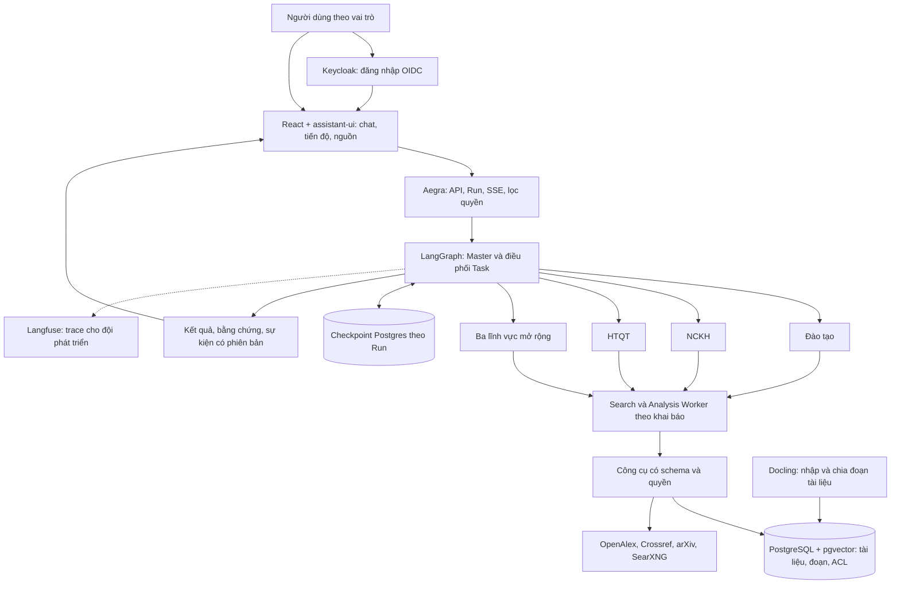

# Kế hoạch xây dựng Credere — phiên bản 3

Cập nhật: 25/09/2026 sau rà soát lần hai, ưu tiên dùng lại mã nguồn mở. Chưa triển khai ứng dụng. Đánh giá từng repo, giấy phép và nguồn tại [OSS_REVIEW.md](./OSS_REVIEW.md); căn cứ kỹ thuật tại [TECHNICAL_REVIEW.md](./TECHNICAL_REVIEW.md); dữ liệu cần nhà trường cung cấp và cách lưu tại [DATA_PLAN.md](./DATA_PLAN.md); dự toán chi phí tại [COST_ESTIMATE.md](./COST_ESTIMATE.md); các bản trước giữ tại [PLAN.v2.md](./PLAN.v2.md) và [PLAN.v1.md](./PLAN.v1.md).

**Căn cứ.** Đã đọc toàn bộ [Bài toán.docx](./Bài%20toán.docx) và xem toàn bộ [ảnh mô hình phân cấp](./2aOboR0Rm398ong6dRyFudWSqCsv9pwaaPdoY5tg.jpg). Hai file mô tả yêu cầu, chưa cung cấp mã nguồn, kho dữ liệu nghiệp vụ, model/API hay hệ thống đăng nhập của trường. DOCX không chứa ảnh nhúng hoặc tệp đính kèm trong gói tài liệu.

**Mục tiêu.** Ứng dụng web tiếng Việt cho trường đại học, hỗ trợ hỏi đáp, tra cứu, phân tích và soạn báo cáo. Master lập kế hoạch, giao việc, kiểm tra và tổng hợp; Worker thực hiện chuyên môn trong phạm vi dữ liệu được cấp. Giữ đầy đủ yêu cầu FR1–FR4/NFR1–NFR3 trong DOCX và mở rộng theo mô hình sáu lĩnh vực trong ảnh.

Phân biệt ba mức: PoC chứng minh dữ liệu/model/cơ chế; MVP nghiệm thu ba lĩnh vực với phạm vi kiểm soát; pilot vận hành thử với người dùng và dữ liệu thực. Hoàn thiện đủ sáu lĩnh vực sau khi mỗi lĩnh vực có nguồn, quyền và tiêu chí chất lượng. PoC không được coi là MVP đã đạt tất cả yêu cầu.

**Các thay đổi chính so với bản 2.** Ưu tiên repo mã nguồn mở đang hoạt động; chỉ tự viết phần lõi của đề bài gồm Master, validator kế hoạch, vòng review, hợp đồng dữ liệu, bằng chứng và quyền. Dùng Aegra làm API/quản lý Run/SSE thay cho tự dựng dispatch; bỏ Celery + Redis khỏi phương án mặc định. Môi trường phát triển chuẩn là WSL2 + Docker. Worker hỗ trợ được khai báo trước trong Task và có trace con. Thêm nguồn học thuật/web cụ thể cho kịch bản NCKH và cách tìm từ khóa tiếng Việt. Trần LLM tính theo chi phí, nâng trần số lời gọi. Hợp đồng dữ liệu dùng đúng tên trường của FR2. Thêm chính sách giấy phép và khóa phụ thuộc.

**Phạm vi Worker.**

| Tác tử | Nhiệm vụ, nguồn dữ liệu | Người dùng theo ảnh | Mức |
| --- | --- | --- | --- |
| Master / Supervisor | Tiếp nhận, phân rã, điều phối, đánh giá và tổng hợp liên lĩnh vực | Ban Giám hiệu | MVP |
| Đào tạo | Quy chế, chương trình, chuẩn đầu ra, tín chỉ, lịch thi; CSDL học vụ | Phòng Đào tạo, giảng viên, sinh viên | MVP |
| NCKH | Đề tài, công bố, quy định nghiên cứu, tài trợ; CSDL đề tài | Phòng NCKH, giảng viên | MVP |
| HTQT | Liên kết, học bổng, trao đổi, hợp tác nghiên cứu; văn bản HTQT, đối tác | Phòng HTQT, Ban Giám hiệu | MVP |
| Tuyển sinh | Chỉ tiêu, điểm chuẩn, ngành, học phí; CSDL tuyển sinh, thông báo | Phòng Tuyển sinh, thí sinh | Bản trình diễn đầu tiên (09/2026), chỉ dùng dữ liệu công khai |
| Nhân sự | Hợp đồng, lương, quy định, KPI; CSDL nhân sự | Phòng Tổ chức, Ban Giám hiệu | Sau MVP |
| Hành chính | Công văn, thủ tục, cơ sở vật chất; văn bản và quy trình | Toàn trường | Sau MVP |
| Search Worker hỗ trợ | Tìm/đọc nguồn nội bộ, học thuật và web, trích bằng chứng, trả nguồn có cấu trúc | Các Worker chuyên môn sử dụng trong quyền người yêu cầu | MVP |
| Analysis Worker hỗ trợ | Chuẩn hóa bảng, so sánh, gọi hàm tính; lưu đầu vào/công thức/kết quả | Các Worker chuyên môn sử dụng trong quyền người yêu cầu | MVP |

Hai Worker hỗ trợ đáp ứng cách gọi trong kịch bản nghiệm thu, không thay thế ba Worker chuyên môn. Worker là vai trò có context/công cụ riêng, không mặc định là một microservice hoặc một máy riêng.

Master khai báo trước trong từng Task các Worker hỗ trợ được phép (allowed_helpers) và số lần gọi tối đa (max_helper_calls). Worker chuyên môn gọi Worker hỗ trợ như một subgraph; mỗi lần gọi có task_id con (ví dụ T1.search.1), kết quả và trace riêng, và tính vào trần của Run. Worker không tự thêm loại hỗ trợ ngoài khai báo; cần thêm việc thì Master lập plan_version mới. Như vậy kế hoạch vẫn có trước khi thực thi và không sinh cây tác tử vô hạn.

Người dùng đơn vị dùng trợ lý chuyên môn được cấp; Supervisor có thể điều phối phía sau mọi phiên. Quyền báo cáo liên đơn vị cấp riêng. Xuất hiện trong cột người dùng không đồng nghĩa có quyền đọc toàn bộ dữ liệu lĩnh vực: sinh viên chỉ xem nguồn công khai và hồ sơ cá nhân được phép; nhân sự có phạm vi riêng theo bản ghi/hành động.

**Kiến trúc.** Một backend có module rõ ràng, một frontend, một CSDL. Cây trong ảnh biểu diễn chuyên môn/quyền. DAG của từng yêu cầu biểu diễn phụ thuộc công việc. Các lượt sửa hữu hạn nằm trong quy trình thực thi, không tạo chu trình của phụ thuộc nghiệp vụ. Phần lõi của đề bài tự viết; hạ tầng xung quanh dùng repo mã nguồn mở.

Các Worker cũng có thể gọi trực tiếp công cụ đơn giản được cho phép; không bắt buộc qua Worker hỗ trợ cho mọi thao tác. Chỉ phân rã khi có lợi cho chuyên môn, nguồn hoặc kiểm chứng.

| Tầng | Dùng lại (mã nguồn mở) | Tự viết |
| --- | --- | --- |
| Điều phối | [LangGraph](https://github.com/langchain-ai/langgraph) 1.x và langgraph-checkpoint-postgres (MIT), là engine duy nhất quản lý Task, phụ thuộc và sửa nội dung trong Run; mẫu LLMCompiler/plan-and-execute làm tham chiếu thiết kế. [Các mẫu workflow](https://docs.langchain.com/oss/python/langgraph/workflows-agents) | Graph Master, validator kế hoạch, subgraph review, registry Worker |
| API, Run, tiến độ | [Aegra](https://github.com/aegra/aegra) (Apache-2.0): threads, Run nền, hủy/join, SSE đọc lại bằng Last-Event-ID, auth handler lọc tài nguyên theo người dùng, thêm route FastAPI | Route tài liệu, bằng chứng, báo cáo, quản trị |
| Frontend | React + TypeScript (Vite), [assistant-ui](https://github.com/assistant-ui/assistant-ui) với @assistant-ui/react-langgraph, shadcn/ui (MIT); [agent-chat-ui](https://github.com/langchain-ai/agent-chat-ui) chỉ để thử nhanh API | Màn hình kế hoạch/tiến độ, bằng chứng, báo cáo |
| Đăng nhập | [Keycloak](https://github.com/keycloak/keycloak) (Apache-2.0): OIDC, vai trò demo, về sau nối SSO của trường | Kiểm tra JWT, ánh xạ vai trò/đơn vị trong auth handler |
| Phân quyền | PostgreSQL ACL + RLS | Bảng ACL, lineage và quy tắc quyền báo cáo |
| Nhập tài liệu | [Docling](https://github.com/docling-project/docling) (MIT) cho PDF/DOCX, OCR khi cần; pypdf, python-docx dự phòng | Lớp chia đoạn mỏng trên HybridChunker, giữ trang/mục/URL |
| Truy xuất | [pgvector](https://github.com/pgvector/pgvector) 0.8.x; full-text cấu hình simple + unaccent; [underthesea](https://github.com/undertheseanlp/underthesea) (Apache-2.0) tách từ tiếng Việt | Truy vấn lai, gộp RRF, ACL trong truy vấn |
| Embedding, rerank | AITeamVN/Vietnamese_Embedding và Vietnamese_Reranker (Apache-2.0); so với multilingual-e5-large-instruct, Qwen3-Embedding-0.6B | Bộ câu có nhãn để chọn model |
| Nguồn ngoài | OpenAlex + [pyalex](https://github.com/J535D165/pyalex), Crossref, arXiv; [SearXNG](https://github.com/searxng/searxng) + [trafilatura](https://github.com/adbar/trafilatura); crawl4ai cho trang cần JS | Công cụ có schema, lưu URL/thời điểm/bản trích |
| Model, chi phí | LangChain init_chat_model cấu hình theo từng Worker (đã chốt: Master gpt-6-sol, Worker gpt-6-luna); dữ liệu giá khởi tạo từ OpenRouter hoặc [LiteLLM](https://github.com/BerriAI/litellm), khóa phiên bản | Bảng giá có ngày hiệu lực, ghi usage, ngân sách Run |
| Trace | [Langfuse](https://github.com/langfuse/langfuse) self-host (lõi MIT) cho đội phát triển | Trace NFR3 cho người dùng trong bảng ứng dụng có ACL |
| Đánh giá | [DeepEval](https://github.com/confident-ai/deepeval) (Apache-2.0) trong pytest; [promptfoo](https://github.com/promptfoo/promptfoo) (MIT) kiểm tra quyền và prompt injection | Bộ câu hỏi JSONL, rubric, fixture tính toán |
| Xuất file | Thư viện chuẩn cho Markdown/CSV; pandoc CLI cho DOCX về sau | Mẫu báo cáo |

**Dispatch.** Aegra giao và chạy cả Run ở nền trên một instance, chưa cần Redis ở MVP; LangGraph vẫn là nơi duy nhất quyết định Task nào chạy. Bảng Task/kết quả/sự kiện trong ứng dụng là bản phản chiếu có phiên bản của thực thi graph; không có scheduler thứ hai tự thay đổi tiến trình. Lưu kết quả theo run_id/task_id/attempt; có khóa chống hai executor cùng điều hành một Run. Quy tắc đồng bộ checkpoint, kết quả và sự kiện phải được thử bằng lỗi giả lập.

Aegra còn ở bản 0.x và có lỗi đã biết về hủy Run (issue #539), nên M-1 có spike kiểm chứng: hủy, dừng tiến trình giữa Run rồi khởi động lại, kết nối lại SSE, lọc quyền theo người dùng và tương thích LangGraph 1.x. Không đạt thì chuyển sang phương án dự phòng: FastAPI tự viết + [Procrastinate](https://github.com/procrastinate-org/procrastinate) (MIT, chỉ cần PostgreSQL, có heartbeat và phát hiện job kẹt) giao cả Run, SSE tự viết. Không dùng Celery + Redis làm mặc định vì Celery không hỗ trợ Windows và thêm một broker. Không tự xây message queue từ PostgreSQL. BackgroundTasks trong API không thay thế yêu cầu hồi phục bền khi tiến trình dừng. [Tài liệu FastAPI về chạy nền](https://fastapi.tiangolo.com/tutorial/background-tasks/#caveat).

**Môi trường và model phải kiểm chứng ở mốc đầu.** Hiện máy có Windows 10 Pro 22H2 (build 19045), khoảng 63,8 GB RAM, CPU 18 lõi/36 luồng, Python 3.13 và Node 25.2.1; chưa tìm thấy docker/psql trong PATH. Đây là kiểm tra môi trường, chưa là benchmark khả năng phục vụ.

Môi trường phát triển chuẩn là WSL2 + Docker: PostgreSQL + pgvector, Keycloak, SearXNG và Langfuse chạy bằng Docker Compose; pgvector không có bản Windows chính thức. Windows 10 đã hết hỗ trợ từ 14/10/2025, nên M-1 phải kiểm tra Docker Desktop còn hỗ trợ bản này; nếu không, dùng Docker Engine trong WSL2 Ubuntu. Volume Docker nằm trong ổ ảo của WSL2, ngoài vùng đồng bộ OneDrive. Chuẩn hóa Node 24 LTS vì Node 25 đã EOL theo [lịch Node.js](https://nodejs.org/en/about/previous-releases). Thử dependency Python trong virtualenv trước khi khóa phiên bản; một số gói chưa hỗ trợ Python 3.13. Pilot chạy trên host Linux.

MVP ưu tiên model qua API; không giả định khả năng chạy model lớn tại máy. Model Master/Worker cấu hình độc lập. Dùng baseline đủ chất lượng, thử Worker tiết kiệm hơn rồi so chi phí của Run đạt chất lượng, gồm cả retry. Nhà cung cấp phải được thử structured output, tool calling, tiếng Việt, lỗi/rate limit và giới hạn ngữ cảnh. Embedding/reranker mã nguồn mở có thể chạy trên CPU với tập tài liệu nhỏ; đo tốc độ trước khi chọn.

**AI Tuyển sinh làm trước (26/09/2026).** Đã chốt dùng API, không mua máy chủ ([LOCAL_HOSTING.md](./LOCAL_HOSTING.md)). Tuyển sinh được làm trước vì toàn bộ dữ liệu là thông tin công khai, nên không cần phiếu xin phép; dùng để trình bày với Ban Giám hiệu. Ba lĩnh vực của đề tài (Đào tạo, NCKH, HTQT) giữ nguyên lộ trình.
- Kho tài liệu: 70 văn bản công khai đã đối chiếu số liệu với bản gốc, tại `~/credere-data/03_xu-ly/tuyen_sinh/sources.json`. Kho đang nằm ở ổ C (thư mục người dùng), không ở `D:\credere-data` như DATA_PLAN.md ghi.
- Trang demo: `python -m app.web`. Bộ câu hỏi thử: `04_danh-gia/tuyen-sinh/poc-30.jsonl`, chạy bằng `scripts/run_eval.py`.
- Bài trình bày nằm ở [presentation/](./presentation/).

**Model đã chốt (26/09/2026, cấu hình A).** Sau hai vòng đo 12 model ([REVIEW_v2.md](./evals/model_probe/results_v2/REVIEW_v2.md)):
- Master: gpt-6-sol.
- Worker chuyên môn và Worker hỗ trợ: gpt-6-luna.
- Dự phòng cho Master: gpt-5.6-sol.
- Cấu hình đối chứng cho NFR2: toàn bộ gpt-6-sol.

Tất cả gọi qua cổng API của nhóm (api.aixingialaire.shop), key trong `~/.credere/.env`. Chi phí theo giá OpenRouter tại [COST_ESTIMATE.md](./COST_ESTIMATE.md).

Điều kiện đi kèm:
- M-1 phải đo gpt-6-luna trên ngữ cảnh dài 20–50 nghìn token (nhiều phiên bản văn bản, nguồn mâu thuẫn) trước khi dùng cho Worker bám nguồn; không đạt thì Worker bám nguồn chuyển sang gpt-6-sol.
  - **Đã đo ngày 26/09/2026 ([REVIEW_longctx.md](./evals/model_probe/results_longctx/REVIEW_longctx.md)): chưa kết luận.**
  - Trên bộ văn bản mô phỏng, gpt-6-luna đúng 100% tới ~202k token. Nhưng cả ba model và một script dò từ khóa đều đạt 100%, nên bài đo không tách được model nào.
  - Được giữ gpt-6-luna khi phát triển, vì mọi kết quả đều qua bước nghiệm thu của gpt-6-sol. Chưa dùng cho pilot trước khi có bài đo phân biệt (M-1b): văn bản thật chuyển bằng Docling, mâu thuẫn không gắn nhãn, JSON claims có trích nguyên văn.
- Không gọi Claude qua cổng này: kênh Claude chèn chỉ dẫn Claude Code ẩn khoảng 508 token mỗi lời gọi.
- Chỉ gửi dữ liệu công khai, mô phỏng hoặc đã lược bỏ qua cổng. Tài liệu nội bộ chỉ gửi khi phiếu xin phép ghi rõ bên trung gian này.
- Cổng không có API xem số dư, nên đối chiếu chi phí trên trang quản lý của cổng.

**Hợp đồng dữ liệu.**

| Đối tượng | Trường chính |
| --- | --- |
| Run | run_id, thread_id (hội thoại trong Aegra), user_id, goal, time_range, status, budget, plan_version |
| Task | task_id, parent_task_id, run_id, worker_type, task_type, goal, context, constraints, depends_on, allowed_helpers, max_helper_calls, acceptance_criteria, attempt, max_retries |
| WorkerResult | task_id, status, data, sources, evidence_refs, artifacts, error, usage, assumptions |
| Review | task_id, accepted, checks, feedback, required_changes, review_version |
| Source | source_id, title, url_or_document_id, published_at, effective_at, retrieved_at, locator, version, access_scope |
| Evidence | evidence_id, claim, source_id, supporting_excerpt, locator, time_range, units, access_scope |
| Event | event_id, run_id, task_id, event_type, timestamp, actor, payload_ref |

Tên trường giữ đúng FR2: chỉ thị có task_id, goal, context, constraints; phản hồi có task_id, status, data, error. context gồm refs (tham chiếu tới dữ liệu được phép) và summary, không sao chép toàn bộ tài liệu cho mọi Worker. Danh tính và quyền do backend gắn từ phiên đăng nhập; kế hoạch LLM không được tự tăng quyền.

**Luồng thực thi.**

1. Xác thực, xác định phạm vi dữ liệu, tạo Run.
2. Master lập kế hoạch: câu hỏi đơn có một Task; yêu cầu tổng hợp có DAG nhỏ. task_type chỉ chọn từ danh mục tra cứu nội bộ, tìm nguồn, trích bằng chứng, tính toán, so sánh và soạn thảo. Mỗi Task khai báo Worker hỗ trợ được gọi và số lần tối đa.
3. Validator kiểm tra schema, ID, phụ thuộc tồn tại/không chu trình, năng lực Worker, Worker hỗ trợ, công cụ, quyền và giới hạn. Kế hoạch sai phải sửa hoặc dừng.
4. Lưu kế hoạch trước Worker đầu tiên và hiển thị bản tóm tắt.
5. Graph chạy Task đã có phụ thuộc được chấp nhận; các Task độc lập chạy đồng thời trong hạn mức.
6. Worker trả dữ liệu, bằng chứng, lỗi và mức sử dụng. Search/Analysis chỉ được gọi theo khai báo của Task, có task_id con, kết quả và trace riêng; không thực thi SQL hoặc mã tùy ý do model sinh.
7. Mã kiểm tra schema, đơn vị, phép tính, vị trí nguồn và ràng buộc. Master xem bằng chứng để đánh giá nội dung. URL tồn tại không đồng nghĩa nguồn hỗ trợ nhận định; nghiệm thu nội dung còn có người chuyên môn.
8. Sửa theo phản hồi cụ thể, tối đa hai lượt sửa mỗi Task, tức tối đa ba lần thực thi. Sửa phải bổ sung nguồn hoặc điều chỉnh dữ liệu/công thức có căn cứ.
9. Hết lượt hoặc chạm hạn mức: đánh dấu thất bại/một phần; chặn phụ thuộc không đủ điều kiện. Thiếu nguồn không được bịa để hoàn tất.
10. Tổng hợp kết quả được chấp nhận, kiểm tra dữ kiện và quyền người nhận, xuất bản một kết quả có phiên bản và lưu lịch sử.

Tham số thử nghiệm ban đầu: tối đa 8 Task nghiệp vụ/Run (không tính các lần gọi Worker hỗ trợ), 3 Task đồng thời và 40 lời gọi LLM toàn Run, tính cả vòng tool bên trong Worker và Worker hỗ trợ. Trần chính là token và tiền của Run. Ước tính kịch bản NCKH chưa sửa lần nào đã cần khoảng 20 lời gọi (lập kế hoạch, bảy Task, Search/Analysis, review và tổng hợp), nên trần 20 lời gọi của bản 2 không đủ. Tool call, retry mạng và thời gian có giới hạn riêng. Điều chỉnh sau PoC. Trần toàn Run ưu tiên hơn số lượt thử lại từng Task. Graph quản lý sửa nội dung; dispatch xử lý khởi động lại Run sau lỗi executor, tránh nhân nhiều vòng retry.

Có hủy và resume. Checkpoint không tự bảo đảm dịch vụ bên ngoài chỉ được gọi đúng một lần; sử dụng idempotency khi có hỗ trợ và ghi nhận phí của lần gọi lại. Hủy ngăn bước chưa chạy; request đã gửi có thể vẫn bị tính phí. Chi tiết bảo đảm thực thi phải được kiểm tra ở M2.

**Dữ liệu và quyền.** Tách checkpoint theo Run, hội thoại theo người dùng, kho tri thức có ACL. Trì hoãn bộ nhớ dài hạn do AI tự ghi. Bộ nhớ chung chỉ trong phạm vi Run và quyền người yêu cầu. Quyền áp dụng tại API, công cụ, truy vấn, tài liệu gốc, SSE, lịch sử, báo cáo và cache.

Luồng tài liệu: nhập → Docling trích văn bản và cấu trúc → kiểm tra chất lượng → chia đoạn → gắn lĩnh vực/nguồn/phiên bản/ngày hiệu lực/quyền → tách từ tiếng Việt → chỉ mục → truy xuất. MVP dùng PDF có văn bản, DOCX, TXT và CSV. OCR bổ sung khi dữ liệu cần, có kiểm tra chất lượng. DOCX dẫn mục/đoạn, PDF dẫn trang, web dẫn URL/thời điểm/bản trích.

Truy xuất lai trong PostgreSQL: cột mã quy chế/số quyết định đã chuẩn hóa để tìm chính xác; full-text cấu hình simple + unaccent trên văn bản đã tách từ bằng underthesea, vì PostgreSQL không có từ điển tiếng Việt; pgvector cho embedding, dữ liệu nhỏ dùng tìm chính xác, chỉ thêm HNSW với iterative scan khi đo thấy cần. Gộp ba danh sách bằng RRF rồi rerank. ACL nằm trong truy vấn và được kiểm tra lại trước khi đưa vào model. Chọn embedding/reranker trên 50–100 câu có nhãn của trường; số liệu công bố giữa các benchmark tiếng Việt không thống nhất nên phải tự đo. Lưu phiên bản model embedding và thử recall sau lọc quyền.

Nguồn ngoài cho Search Worker: OpenAlex là nguồn chính để đếm và mô tả công bố về AI trong nghiên cứu 2023–2025; từ 13/02/2026 cần API key miễn phí, hạn mức 1 USD/ngày, tính phí theo loại truy vấn. Crossref xác minh DOI, gửi kèm mailto. arXiv cho bản tiền ấn phẩm, không quá một request mỗi 3 giây. Web chung qua SearXNG tự host rồi trích nội dung bằng trafilatura. Mọi kết quả lưu URL, thời điểm truy xuất và bản trích. Dữ liệu nội bộ của trường dùng cho đơn giá, nhân lực và bối cảnh; thiếu thì ghi giả định.

Báo cáo/cache lưu quan hệ tới nguồn đã dùng. Người nhận phải được phép xem dữ liệu làm căn cứ; nếu không, phải tạo lại từ tập được phép hoặc dùng quy tắc tổng hợp đã xác định. Kiểm tra lại quyền khi mở, resume, xuất kết quả hoặc sau thu hồi quyền. Tóm tắt không tự biến dữ liệu hạn chế thành công khai. Nội dung tài liệu/web không được thay đổi quyền hay công cụ. MVP chưa thêm thư viện guardrails; phòng prompt injection bằng thiết kế (nội dung truy xuất là dữ liệu, công cụ có allowlist, đầu ra lọc theo ACL) và kiểm thử bằng promptfoo.

RLS là lớp kiểm soát bổ sung tại CSDL. Runtime không dùng superuser/BYPASSRLS; xử lý đúng quyền chủ bảng và ngữ cảnh người dùng khi dùng connection pool. [Tài liệu PostgreSQL RLS](https://www.postgresql.org/docs/current/ddl-rowsecurity.html).

Các nhóm dữ liệu: người dùng/vai trò lấy từ Keycloak, bảng ứng dụng giữ permissions/grants; documents/versions/chunks/grants; threads và runs gốc do Aegra quản lý, bảng ứng dụng giữ runs/tasks/attempts/results dạng bản phản chiếu; sources/evidence/reviews/artifacts/events/usage_records/lineage. Bảng nghiệp vụ nằm trong schema riêng, migration có phiên bản bằng Alembic, không sửa bảng của Aegra. File runtime, CSDL và bí mật đặt ngoài vùng đồng bộ OneDrive; mã nguồn/tài liệu có thể ở credere.

**Giao diện theo thứ tự giá trị.**

| Khu vực | MVP |
| --- | --- |
| Hội thoại | Trợ lý được phép, yêu cầu, đính kèm, câu trả lời/nguồn; lỗi và trạng thái rõ |
| Tiến độ | Kế hoạch dạng danh sách, Task, phụ thuộc, Worker, trạng thái, lần sửa, hủy |
| Kho tài liệu | Upload, lĩnh vực, phiên bản, quyền, tình trạng xử lý |
| Báo cáo/lịch sử | Mở lại, xem bằng chứng, bảng so sánh/chi phí, xuất Markdown/CSV |
| Quản trị tối thiểu | Cấu hình Worker/model, hạn mức và trace theo quyền; người dùng/vai trò quản lý trong Keycloak |

Chat + tiến độ + nguồn được làm trước trên assistant-ui. Đồ thị tương tác, dashboard nâng cao và xuất DOCX/PDF sau khi luồng cốt lõi đạt chất lượng. Nền sáng, xanh đậm, thanh bên và bố cục đọc báo cáo là đề xuất; chưa có nhận diện thương hiệu đầu vào. Ưu tiên tiếng Việt, bàn phím, độ tương phản và responsive.

**Theo dõi và chi phí.** Ghi hành động, Worker, model/prompt phiên bản, nguồn, công cụ, kết quả, thời gian, token, quyết định nghiệm thu; che khóa bí mật/dữ liệu nhạy cảm và giới hạn người xem. Không yêu cầu lưu suy luận nội bộ của model. Trace nghiệp vụ theo NFR3 lưu trong bảng ứng dụng có ACL. Langfuse self-host dùng cho đội phát triển để xem trace chi tiết, phiên bản prompt và dataset; bản mã nguồn mở không có RBAC theo project nên không mở cho người dùng cuối, và phải che dữ liệu nhạy cảm trước khi gửi.

Tính chi phí toàn Run từ từng model, tìm nguồn/công cụ và embedding; giá có ngày hiệu lực. Bảng giá lấy dữ liệu khởi tạo từ bảng giá model của LiteLLM (khóa phiên bản), sau đó xác nhận theo trang giá nhà cung cấp. Chi phí dịch vụ AI khác với ngân sách triển khai trong báo cáo nghiệp vụ. Chưa có đơn giá thì chỉ hiển thị mức sử dụng. Nhánh đồng thời đặt trước ngân sách dự kiến theo giới hạn token rồi quyết toán. Đo p50/p95, tỷ lệ lỗi/retry và chi phí Run đạt chất lượng trước khi chốt SLO/ngân sách.

**Chính sách mã nguồn mở.** Ưu tiên repo đang hoạt động, giấy phép MIT/Apache-2.0/BSD/PostgreSQL. Không liên kết trực tiếp mã AGPL/GPL vào ứng dụng; dịch vụ AGPL như SearXNG chạy nguyên bản trong container riêng; công cụ GPL như pandoc gọi qua tiến trình ngoài. Khóa phiên bản kèm hash và cập nhật có kiểm soát: LiteLLM 1.82.7 và 1.82.8 trên PyPI từng bị chèn mã độc ngày 24/03/2026. Kiểm tra lại giấy phép và tình trạng repo trước mỗi mốc.

Không dùng làm lõi: Dify và Open WebUI (giấy phép riêng hạn chế), Onyx (SSO/RBAC thuộc bản Enterprise), máy chủ LangGraph chính thức langgraph-api tự host (Elastic-2.0, cần license key), langgraph-supervisor và open_deep_research (đã archive), PyMuPDF (AGPL), VnCoreNLP (GPL), ParadeDB/VectorChord (AGPL/ELv2, không chạy trên Windows), Celery (không hỗ trợ Windows), llm-guard (chưa hỗ trợ Python 3.13). Lý do và nguồn chi tiết tại [OSS_REVIEW.md](./OSS_REVIEW.md).

**Các mốc sau điều chỉnh.**

| Mốc | Công việc | Điều kiện hoàn thành |
| --- | --- | --- |
| M-1 — PoC khả thi | Cài WSL2 + Docker; tập nguồn đại diện, 20 câu PoC; spike Aegra (hủy, crash/khởi động lại, SSE kết nối lại, lọc quyền, LangGraph 1.x); thử Docling trên tài liệu mẫu; so sánh embedding/reranker; lấy key OpenAlex và thử dữ liệu NCKH; thử model/bảng tính | Có số đo, bằng chứng cho case NCKH và hướng xử lý điểm yếu; quyết định giữ Aegra hay chuyển phương án dự phòng; đủ dữ liệu mới mở rộng |
| M0 — Nền tảng | Docker Compose (PostgreSQL + pgvector, Keycloak, SearXNG, Langfuse); khung Aegra và graph; realm Keycloak với vai trò demo; schema nghiệp vụ và migration Alembic; khung frontend assistant-ui; registry Worker | API hoạt động qua Aegra; đăng nhập Keycloak; schema/quyền thực thi được; dữ liệu mẫu có nhãn |
| M1 — Một luồng hoàn chỉnh | Master → NCKH → tìm nguồn/tính toán → đánh giá → báo cáo, UI tối thiểu | Kế hoạch có trước thực thi; bằng chứng và số liệu kiểm chứng được |
| M2 — Điều phối bền | Graph quản lý Task; Run nền trên Aegra, phụ thuộc/song song, checkpoint, hạn mức, chống trùng, hủy/resume, SSE đọc lại; đối soát Run bị kẹt | Qua kiểm tra crash, timeout, đồng thời, kết nối lại và giới hạn; không xuất bản kết quả trùng |
| M3 — Ba lĩnh vực | Đào tạo, NCKH, HTQT; Search/Analysis hỗ trợ, dữ liệu/công cụ/rubric từng lĩnh vực | Đúng năng lực, nguồn, quyền và tính toán; có ca liên lĩnh vực |
| M4 — Web MVP | Hoàn thiện năm khu vực ở mức tối thiểu, lịch sử, xuất file, responsive | Trọn luồng theo từng vai trò và trạng thái lỗi |
| M5 — Nghiệm thu | Bộ đánh giá cố định chạy bằng DeepEval trong pytest; kiểm tra quyền/prompt injection bằng promptfoo; kịch bản đề bài, chi phí/hồi phục; tài liệu chạy | Đạt FR/NFR và tiêu chí bên dưới; có báo cáo kết quả thực tế |
| Pilot | Host Linux, dữ liệu/tài khoản thật phạm vi hẹp, backup/phục hồi, theo dõi và xử lý phản hồi | Đầu mối nghiệp vụ xác nhận, vận hành và quyền đã được thử |
| M6 — Sáu lĩnh vực | Tuyển sinh, Nhân sự, Hành chính với dữ liệu/quyền/công cụ/test riêng | Đủ mô hình ảnh; thêm Worker qua registry, không thay logic lõi Master |

Cấu trúc dự kiến: infra/compose.yaml; backend/aegra.json; backend/app/graphs/ (Master, review); backend/app/workers/ (Worker và registry); backend/app/tools/; backend/app/retrieval/; backend/app/routes/ (route FastAPI thêm vào Aegra); backend/app/auth.py (auth handler dùng JWT Keycloak); backend/app/db/ (schema nghiệp vụ, Alembic); frontend/; tests/; evals/datasets/; evals/promptfoo/; docs/. Worker khai báo ID, năng lực, schema, model, công cụ, Worker hỗ trợ được gọi, quyền cần dùng và tiêu chí.

**Kịch bản nghiệm thu NCKH.** Master xác định khoảng thời gian, chỉ số, tiêu chí chọn ba case và đơn vị chi phí. Đề xuất mặc định ba năm lịch hoàn tất gần nhất: tại ngày lập kế hoạch là 2023–2025; năm tới là 2027. Đây là giả định hiển thị rõ, cho phép đổi thành 36 tháng gần nhất hoặc mốc khác.

| Task | Nội dung | Phụ thuộc |
| --- | --- | --- |
| T0 | Master lập tiêu chí/thời gian/nguồn/phạm vi | Yêu cầu |
| T1 | NCKH giao Search tìm/đọc nguồn cho ba case (OpenAlex, Crossref, arXiv, web, nguồn nội bộ) và thu bằng chứng; allowed_helpers = search | T0 |
| T2 | Thu đầu vào triển khai/đơn giá/nhân lực; dùng Đào tạo/HTQT nếu phù hợp | T0; độc lập với T1 |
| T3 | NCKH giao Analysis chuẩn hóa chỉ số và bảng so sánh; allowed_helpers = analysis | T1 được chấp nhận |
| T4 | Lộ trình, khối lượng × đơn giá, một lần/định kỳ, giả định | T2 và T3 được chấp nhận |
| T5 | Master rà soát nguồn, số liệu, mâu thuẫn; sửa có giới hạn | T1–T4 |
| T6 | Báo cáo gồm kết quả, ba case, lộ trình, chi phí, hạn chế và nguồn | Đủ Task bắt buộc đạt |

Phân biệt năng suất, số lượng/chất lượng công bố và bằng chứng về tác động; quan sát tăng/giảm không tự chứng minh quan hệ nhân quả. Chi phí phải có nguồn hoặc ghi giả định. Thiếu ba case đủ bằng chứng thì báo thiếu, không đánh dấu đạt. Thêm ca liên lĩnh vực riêng; không ép mỗi câu hỏi gọi đủ mọi Worker.

**Tiêu chí kiểm tra.** PoC dùng 20 câu để tìm lỗi; chuẩn bị riêng bộ nghiệm thu 60 tình huống: 30 tra cứu (10/lĩnh vực), 10 tổng hợp/liên lĩnh vực, 10 thiếu dữ liệu và 10 sai quyền. Có nguồn/đáp án hoặc rubric, không dùng bộ nghiệm thu để chỉnh prompt rồi báo chất lượng. Bộ câu hỏi lưu dạng JSONL có phiên bản trong git.

| Yêu cầu | Cách kiểm tra |
| --- | --- |
| FR1 lập kế hoạch | Kế hoạch hợp lệ, gồm khai báo Worker hỗ trợ, lưu trước sự kiện Worker đầu tiên |
| FR1 tuần tự/song song | Fixture chứng minh Task độc lập chồng thời gian; Task phụ thuộc đợi dữ liệu được chấp nhận |
| FR2 giao thức | Schema sai bị chặn; kết quả gắn đúng Task; kiểm tra quyền do backend |
| FR3 trạng thái | Crash/resume không trộn phiên, không mất kết quả đã lưu hoặc ghi đè kết quả song song |
| FR4 sửa lỗi | Tạo bảng sai/thiếu nguồn; phản hồi cụ thể, sửa có căn cứ, dừng đúng N lượt và hạn mức Run |
| NFR1 module hóa | Thêm Worker qua registry/module riêng mà không đổi lõi Master |
| NFR2 hiệu năng/chi phí | Model cấu hình riêng; đo chi phí của Run đạt chất lượng, tỷ lệ retry và tác động chạy song song |
| NFR3 trace | Báo cáo truy ngược tới Task, Task con của Worker hỗ trợ, nguồn, bằng chứng, kết quả và quyết định nghiệm thu |
| Phân quyền | Cho phép/từ chối đúng tại API, nguồn, model payload, lịch sử, SSE, xuất file và sau thu hồi quyền; thêm kịch bản promptfoo rbac, bola, rag-document-exfiltration |
| Giao diện | Đăng nhập → gửi → tiến độ → mở bằng chứng → lịch sử → xuất; kiểm tra lỗi/hủy |

Ngưỡng đề xuất: định tuyến đúng ít nhất 90% trong 40 ca có dữ liệu; bằng chứng cần thiết ở top 8 ít nhất 90% của 30 ca tra cứu; ít nhất 95% nhận định thực tế được kiểm tra có nguồn hỗ trợ; ít nhất 9/10 ca thiếu dữ liệu xử lý đúng; ít nhất 85% trong 40 ca có dữ liệu đạt rubric. Bộ test quyền không có rò rỉ; fixture tính toán đạt 100%; kịch bản ba case phải đạt đủ tiêu chí bắt buộc. Đây là ngưỡng chờ xác nhận với người nghiệm thu, chưa phải kết quả.

Đo p50/p95 trên tập cố định và thử 3 Run đồng thời; chốt SLO/chi phí sau PoC. Kiểm tra lỗi/scheduler bằng provider giả lập; chất lượng bằng model/nguồn thật và người chuyên môn. Lặp ca trọng yếu để thấy biến động; báo số mẫu và số lần chạy. Chi tiết trong TECHNICAL_REVIEW.md.

**Công sức và đầu vào.** Ước lượng sơ bộ với một kỹ sư có kinh nghiệm, nguồn/model sẵn có, người nghiệp vụ phản hồi và UI tiêu chuẩn: PoC 4–6 ngày công, tăng so với bản 2 vì thêm cài WSL2/Docker và các spike Aegra, Docling, embedding; thêm 20–35 ngày công cho MVP, tổng khoảng 5–8 tuần làm việc. Dùng lại Aegra, Keycloak và assistant-ui giảm công tự viết quản lý Run, SSE, đăng nhập và chat, nhưng thêm công tích hợp và cấu hình; chưa đủ số đo để giảm ước lượng, sẽ tính lại sau M-1. Pilot thêm 10–20 ngày công. Chưa gồm tích hợp CSDL trường, SSO, OCR phức tạp hoặc chờ dữ liệu/hạ tầng; chưa đủ căn cứ ước lượng toàn trường. Đây không phải lịch cam kết.

M-1 cần model API, API key OpenAlex, tập nguồn thật đại diện, ngân sách thử và quyền cài WSL2/Docker trên máy. Có thể thử cơ chế trên mẫu giả lập nhưng không kết luận chất lượng nghiệp vụ từ mẫu đó. M5 cần người xác nhận rubric và quyền dùng tài liệu. Pilot/M6 cần ma trận quyền chi tiết, nguồn/API, môi trường host Linux, backup và người chịu trách nhiệm vận hành.

**Bàn giao.** Mã nguồn, cấu hình mẫu không có bí mật, infra/compose.yaml, danh sách phụ thuộc đã khóa phiên bản kèm giấy phép, migration, registry Worker/công cụ, dữ liệu demo có nhãn, bộ kiểm thử/đánh giá, báo cáo nghiệm thu và hướng dẫn chạy/triển khai. MVP hoàn thành ở M5; pilot và phạm vi sáu lĩnh vực có điều kiện bàn giao riêng như trên.
