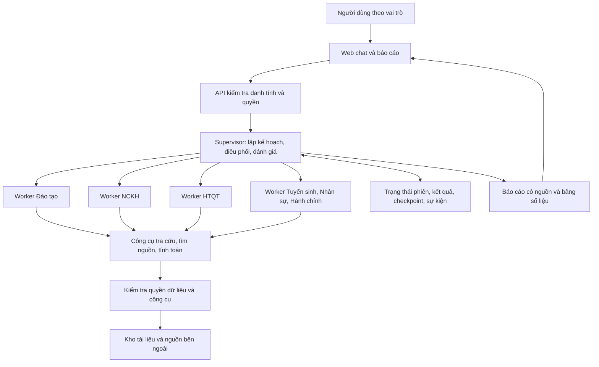

# Kế hoạch xây dựng Credere

Ngày lập: 23/09/2026. Trạng thái: đề xuất triển khai; chưa xây dựng ứng dụng.

**Căn cứ và hiện trạng.** Đã đọc toàn bộ nội dung [Bài toán.docx](./Bài%20toán.docx) và xem toàn bộ [ảnh mô hình phân cấp](./2aOboR0Rm398ong6dRyFudWSqCsv9pwaaPdoY5tg.jpg). Thư mục ban đầu chỉ có hai file này, chưa có mã nguồn, dữ liệu nghiệp vụ, cấu hình dịch vụ AI hoặc thiết kế giao diện. DOCX không chứa ảnh nhúng hay tệp đính kèm trong gói tài liệu.

Tài liệu yêu cầu hệ thống AI đa tác tử Orchestrator–Worker, tối thiểu ba Worker: Đào tạo, Nghiên cứu khoa học (NCKH), Hợp tác quốc tế (HTQT). Ảnh bổ sung Tuyển sinh, Nhân sự, Hành chính và phân quyền theo cơ cấu nhà trường. Bản MVP thực hiện ba Worker bắt buộc; phạm vi hoàn chỉnh gồm đủ sáu Worker trong ảnh.

**Giả định để lập kế hoạch.** Xây dựng ứng dụng web tiếng Việt cho một trường đại học, ưu tiên máy tính và thích ứng trên điện thoại. Giai đoạn đầu hỗ trợ hỏi đáp, tra cứu, phân tích và soạn báo cáo. Tích hợp CSDL học vụ, nhân sự hoặc cổng thông tin khi có giao diện kết nối và quyền truy cập. Công nghệ, màn hình, giới hạn thực thi và định dạng xuất dưới đây là đề xuất thiết kế, không phải các lựa chọn đã được ấn định trong đầu vào.

**Phạm vi tác tử được đối chiếu với tài liệu.**

| Tác tử | Chuyên môn và nguồn dữ liệu | Người dùng theo ảnh | Phạm vi |
| --- | --- | --- | --- |
| Supervisor / Master | Tiếp nhận, phân rã, điều phối, đánh giá và tổng hợp báo cáo liên lĩnh vực | Ban Giám hiệu | MVP |
| Đào tạo | Quy chế, chương trình, chuẩn đầu ra, tín chỉ, lịch thi; quy chế đào tạo và CSDL học vụ | Phòng Đào tạo, giảng viên, sinh viên | MVP |
| NCKH | Đề tài, công bố, tài trợ, định hướng nghiên cứu; CSDL đề tài và quy định NCKH | Phòng NCKH, giảng viên | MVP |
| HTQT | Chương trình liên kết, học bổng, trao đổi, hợp tác nghiên cứu; văn bản HTQT và danh sách đối tác | Phòng HTQT, Ban Giám hiệu | MVP |
| Tuyển sinh | Chỉ tiêu, điểm chuẩn, ngành học, học phí; CSDL tuyển sinh và thông báo | Phòng Tuyển sinh, thí sinh | Bản đầy đủ |
| Nhân sự | Hợp đồng, lương, quy định nhân sự, KPI; CSDL nhân sự và quy định HR | Phòng Tổ chức, Ban Giám hiệu | Bản đầy đủ |
| Hành chính | Công văn, thủ tục, cơ sở vật chất; văn bản hành chính và quy trình | Toàn trường | Bản đầy đủ |

Người dùng từng đơn vị truy cập trợ lý chuyên môn trong phạm vi được cấp. Supervisor có thể điều phối phía sau mọi phiên; quyền tổng hợp liên đơn vị dành cho vai trò được cấp phép. Vai trò có trong bảng không đồng nghĩa được đọc mọi bản ghi của lĩnh vực: sinh viên chỉ xem thông tin công khai và hồ sơ cá nhân được phép; dữ liệu nhân sự có quyền chi tiết riêng.

**Kiến trúc đề xuất.** Cây tổ chức trong ảnh xác định chuyên môn và quyền. Mỗi yêu cầu cụ thể tạo một DAG nhiệm vụ để xác định bước chờ dữ liệu và bước chạy song song. Vòng sửa kết quả giới hạn tại từng nhiệm vụ, không tạo chu trình trong DAG phụ thuộc nghiệp vụ.

| Thành phần | Lựa chọn đề xuất và căn cứ |
| --- | --- |
| Frontend | React + TypeScript; xây dựng các màn hình từ component và trạng thái giao diện. [Tài liệu React](https://react.dev/learn). |
| Backend | Python + FastAPI; Pydantic định nghĩa và kiểm tra dữ liệu. FastAPI hỗ trợ OpenAPI/JSON Schema. [Tài liệu FastAPI](https://fastapi.tiangolo.com/). |
| Điều phối | LangGraph kết hợp bước xử lý cố định và bước LLM; dự án tự xây quy tắc DAG, tiêu chí đánh giá và giới hạn. [Tài liệu LangGraph](https://docs.langchain.com/oss/python/langgraph/overview). |
| Lưu trạng thái | Checkpointer lưu bền để tiếp tục phiên; dữ liệu dùng qua nhiều phiên có phạm vi riêng. [Tài liệu persistence](https://docs.langchain.com/oss/python/langgraph/persistence). |
| CSDL và tìm kiếm | PostgreSQL lưu nghiệp vụ/quyền/nhiệm vụ; pgvector hỗ trợ tìm đoạn tài liệu tương đồng, kết hợp tìm từ khóa. [Kho mã nguồn pgvector](https://github.com/pgvector/pgvector). |
| Lớp kiểm soát dữ liệu | Có thể bổ sung PostgreSQL Row-Level Security; runtime không dùng superuser/BYPASSRLS và phải xử lý quyền chủ bảng đúng. [Tài liệu RLS](https://www.postgresql.org/docs/current/ddl-rowsecurity.html). |

Tách tiến trình chạy nhiệm vụ khỏi vòng đời HTTP. Bản đầu dùng hàng đợi lưu trong PostgreSQL với lease và khóa chống nhận trùng; web nhận sự kiện tiến độ qua SSE. Khóa phiên bản thư viện sau kiểm tra tương thích. Bộ kết nối LLM cho phép cấu hình nhà cung cấp/model: Master dùng cấu hình suy luận mạnh hơn, Worker dùng cấu hình tiết kiệm hơn; chưa chọn tên model hoặc giả định giá.

**Hợp đồng dữ liệu cần định nghĩa trước khi triển khai.**

| Đối tượng | Trường chính đề xuất |
| --- | --- |
| Run | run_id, user_id, conversation_id, goal, time_range, status, budget, plan_version |
| Task | task_id, run_id, worker_type, goal, context_refs, constraints, depends_on, acceptance_criteria, attempt, max_retries |
| WorkerResult | task_id, status, data, sources, artifacts, error, usage, assumptions |
| Review | task_id, accepted, checks, feedback, required_changes, review_version |
| Source | source_id, title, url_or_document_id, published_at, retrieved_at, page_or_section, version, access_scope |
| Event | event_id, run_id, task_id, event_type, timestamp, actor, payload_ref |

Backend gắn danh tính và phạm vi quyền từ phiên đăng nhập; LLM không tự cấp quyền qua nội dung kế hoạch. Dùng tham chiếu dữ liệu để tránh sao chép toàn bộ tài liệu vào mọi Worker.

**Luồng xử lý một yêu cầu.**

1. Xác thực người dùng, xác định phạm vi dữ liệu và tạo Run.
2. Master sinh kế hoạch: mục tiêu từng Task, Worker, phụ thuộc, nguồn cần tìm và tiêu chí đạt.
3. Kiểm tra schema, ID duy nhất, phụ thuộc tồn tại, không có chu trình, Worker đã đăng ký, công cụ được phép và giới hạn tài nguyên.
4. Lưu kế hoạch trước khi chạy Worker; hiển thị kế hoạch tóm tắt và tiến độ.
5. Scheduler chạy Task có các phụ thuộc đã được nghiệm thu. Task độc lập chạy song song với giới hạn cấu hình được; đề xuất ban đầu là ba.
6. Worker trả kết quả có cấu trúc, nguồn, bảng tính và lỗi nếu có. Lưu kết quả từng Task riêng; cập nhật trạng thái dùng giao dịch/phiên bản để tránh ghi đè khi chạy song song.
7. Mã kiểm tra schema, phép tính, nguồn và điều kiện bắt buộc; Master đánh giá nội dung, mâu thuẫn và phần cần bổ sung.
8. Khi cần sửa, lưu phản hồi cụ thể rồi giao lại Task. Đề xuất max_retries = 2, tức tối đa ba lần thực thi. Toàn Run có trần thời gian, số lần gọi model/công cụ và ngân sách riêng.
9. Hết lượt sửa thì Task thất bại; Task phụ thuộc bị chặn. Trả thất bại hoặc báo cáo một phần có ghi phần thiếu; chỉ đánh dấu hoàn tất khi đạt đủ tiêu chí bắt buộc.
10. Master tổng hợp kết quả được chấp nhận, kiểm tra thống nhất dữ kiện, xuất báo cáo và lưu lịch sử.

Phân biệt retry lỗi mạng/dịch vụ với sửa lỗi nội dung; cả hai đều có giới hạn. Có timeout, hủy Run và tiếp tục từ checkpoint. Idempotency hạn chế tạo Task/lưu kết quả trùng. Nếu nhà cung cấp không hỗ trợ idempotency thì gọi lại sau gián đoạn vẫn có thể phát sinh phí và phải được ghi nhận.

**Bộ nhớ, dữ liệu và phân quyền.** Shared Global State là trạng thái chung trong một Run và phạm vi quyền của người dùng. Mỗi Worker chỉ nhận dữ liệu cần cho nhiệm vụ. Kiểm tra quyền tại API, công cụ, truy vấn, tải file, SSE, báo cáo và lịch sử; cache và bộ nhớ hội thoại dùng cùng phạm vi quyền. Chỉ đoạn tài liệu được phép mới được đưa vào LLM. Nội dung web/tài liệu là dữ liệu tham khảo, không được thay đổi quyền hoặc quy tắc công cụ.

Các nhóm bảng chính: users, roles, permissions, user_roles; documents, document_versions, chunks, document_grants; conversations, messages; runs, tasks, task_attempts, task_results; sources, reviews, artifacts, events, usage_records. Checkpoint của framework lưu riêng, gắn đúng chủ sở hữu phiên.

Luồng tài liệu: tải file → trích văn bản → kiểm tra chất lượng → chia đoạn → gắn lĩnh vực/nguồn/phiên bản/quyền → tạo chỉ mục → tra cứu. MVP ưu tiên PDF có lớp văn bản, DOCX, TXT. Bổ sung OCR khi bộ dữ liệu có ảnh/PDF scan; đánh dấu phần chất lượng thấp để kiểm tra. Bảng nghiệp vụ nhập CSV hoặc kết nối truy vấn chỉ đọc theo schema được phép.

Worker dùng chung công cụ tìm nội bộ, tìm nguồn bên ngoài, đọc nguồn và tính toán. “Worker tìm kiếm” và “Worker tính toán/phân tích” trong kịch bản nghiệm thu được hiện thực thành nhiệm vụ hỗ trợ có trace riêng do Worker NCKH sử dụng. Khi cần có thể tách thành Worker kỹ thuật qua cùng registry; ba Worker chuyên môn vẫn có đầy đủ vai trò.

Nhận định thực tế phải liên kết đến bằng chứng đã đọc. Nguồn lưu tiêu đề, ngày, đường dẫn/tài liệu, trang/mục và đoạn hỗ trợ. Số tự tính lưu đầu vào, đơn vị, công thức và giả định. Thiếu nguồn thì báo thiếu; dữ liệu mẫu có nhãn rõ ràng.

**Giao diện đề xuất gồm năm khu vực.**

| Khu vực | Chức năng |
| --- | --- |
| Hội thoại | Chọn trợ lý được phép, gửi yêu cầu, đính kèm, xem câu trả lời và nguồn; trạng thái trống/lỗi/đang chạy rõ ràng |
| Tiến độ nhiệm vụ | Kế hoạch, phụ thuộc, Worker, trạng thái, kết quả tóm tắt, số lần sửa và lý do; hủy tác vụ |
| Kho tri thức | Tài liệu, lĩnh vực, phiên bản, quyền và tình trạng xử lý |
| Báo cáo và lịch sử | Xem lại báo cáo, bảng so sánh/chi phí và nguồn; xuất Markdown/CSV trong MVP |
| Quản trị | Vai trò, Worker, cấu hình model, giới hạn sử dụng và nhật ký theo quyền |

Định hướng hình thức: nền sáng, xanh đậm chủ đạo, thanh bên điều hướng, vùng nội dung rộng cho bảng/báo cáo. Đây là đề xuất vì ảnh đầu vào chưa cung cấp nhận diện thương hiệu. Ưu tiên đọc tiếng Việt, thao tác bàn phím, độ tương phản và responsive; cấu hình kỹ thuật đặt ở khu vực quản trị.

**Quan sát vận hành và chi phí.** Ghi Worker được giao, phiên bản prompt/model, nguồn đầu vào, lời gọi công cụ, kết quả, thời gian, token và lý do chấp nhận/từ chối. Trace ghi hành động và bằng chứng, không yêu cầu suy luận nội bộ của model. Che dữ liệu nhạy cảm/khóa bí mật trong log và giới hạn người xem.

Giới hạn số Task, số lần gọi công cụ/model, lượt sửa, ngữ cảnh, thời gian và ngân sách mỗi Run. Chi phí AI tính từ mức sử dụng và bảng giá có ngày hiệu lực; chưa có đơn giá thì chỉ hiển thị mức sử dụng. Chi phí triển khai trong báo cáo nghiệp vụ là bảng ước tính riêng, phải có giả định và công thức. Hiện chưa đủ căn cứ để đưa giá hoặc cam kết hiệu năng bằng con số.

**Các mốc triển khai theo thứ tự phụ thuộc.**

| Mốc | Công việc | Sản phẩm và điều kiện hoàn thành |
| --- | --- | --- |
| M0 — Nền tảng | Khởi tạo frontend/backend, cấu hình môi trường, schema, registry, vai trò và dữ liệu mẫu | Web gọi được API; dữ liệu mẫu có nhãn; schema kiểm tra được; quyền thực thi tại backend |
| M1 — Một luồng hoàn chỉnh | Nhập tài liệu; nối model thật khi có cấu hình; Master → NCKH tra cứu → đánh giá → tổng hợp; UI chat tối thiểu | Một báo cáo có nguồn và trace; kế hoạch lưu trước thực thi; nguồn mở được và hỗ trợ nội dung |
| M2 — Bộ điều phối | DAG, song song/tuần tự, retry, checkpoint, giới hạn, hủy/tiếp tục, tiến độ | Qua kiểm tra phụ thuộc, thực thi đồng thời, lỗi, khởi động lại và trần retry |
| M3 — Ba Worker bắt buộc | Đào tạo, NCKH, HTQT với chuyên môn/công cụ/nguồn riêng; tìm nguồn thật và tính toán | Chọn đúng Worker; dùng đúng nguồn/quyền; xử lý đơn và liên lĩnh vực; phép tính tái lập được |
| M4 — Trải nghiệm sử dụng | Hoàn thiện năm khu vực, quản trị tài liệu/quyền, lịch sử, xuất file và responsive | Hoàn thành luồng gửi yêu cầu, theo dõi, mở nguồn, xem lại và xuất báo cáo với từng vai trò |
| M5 — Nghiệm thu MVP | Kịch bản trong đề, quyền, dữ liệu thiếu, kết quả sai, giới hạn; hướng dẫn cài đặt/demo | Báo cáo nghiệm thu và MVP tái hiện được, đạt tiêu chí bên dưới bằng bằng chứng |
| M6 — Đủ mô hình trong ảnh | Tuyển sinh, Nhân sự, Hành chính; dữ liệu/quyền riêng và kết nối nguồn sẵn có | Đủ sáu lĩnh vực; thêm Worker qua registry không đổi lõi Master; qua kiểm tra chuyên môn/quyền |

Ưu tiên chứng minh M1 trước khi mở rộng màn hình. Một phần M4 có thể thực hiện song song sau khi hợp đồng API ổn định. Đây là thứ tự công việc, chưa phải cam kết lịch; cần biết nhân lực, thời hạn, dữ liệu và hạ tầng để ước lượng có căn cứ.

Cấu trúc mã dự kiến: frontend/; backend/app/api/; backend/app/orchestration/; backend/app/workers/; backend/app/tools/; backend/app/retrieval/; backend/app/auth/; backend/app/db/; tests/; evals/; docs/. Worker mới khai báo ID, năng lực, schema, model, công cụ, quyền cần dùng và tiêu chí đánh giá trong registry.

**Kịch bản nghiệm thu bám sát đề bài.** Phân tích tác động của AI đến kết quả NCKH trong ba năm qua, so sánh ba case study và đề xuất lộ trình cùng chi phí cho năm tới.

Ghi rõ khoảng thời gian trong kế hoạch. Đề xuất mặc định là ba năm lịch hoàn tất gần nhất: tại ngày lập tài liệu là 2023–2025, năm tới là 2027. Đây là giả định; người dùng có thể đổi sang 36 tháng gần nhất hoặc mốc khác. Không trộn giai đoạn dữ liệu mà thiếu giải thích.

| Task | Nội dung | Phụ thuộc |
| --- | --- | --- |
| T0 | Master xác định thời gian, tiêu chí case, chỉ số, đơn vị chi phí và phạm vi nguồn | Yêu cầu |
| T1 | NCKH tìm/đọc nguồn cho ba case, thu số liệu và hạn chế phương pháp | T0 |
| T2 | Thu đầu vào triển khai, hạng mục chi phí, nhu cầu nhân sự/đào tạo; gọi Đào tạo/HTQT khi phù hợp | T0; độc lập với T1 |
| T3 | Chuẩn hóa chỉ số/thời gian và bảng so sánh; phân biệt tương quan với bằng chứng tác động | T1 được chấp nhận |
| T4 | Lộ trình, khối lượng × đơn giá, chi phí một lần/định kỳ và phương án giả định | T2, T3 được chấp nhận |
| T5 | Master kiểm tra nguồn, phép tính, mâu thuẫn và tiêu chí; yêu cầu sửa có giới hạn | T1–T4 |
| T6 | Báo cáo: kết quả, ba case, lộ trình, ngân sách, giả định, phần thiếu và nguồn | Các Task bắt buộc đạt |

Chỉ gọi Đào tạo/HTQT khi cần chuyên môn đó. Bổ sung tình huống liên lĩnh vực riêng để chứng minh phối hợp cả ba Worker; không ép mọi câu hỏi gọi tất cả tác tử.

**Ma trận kiểm tra và điều kiện nghiệm thu.**

| Yêu cầu | Bằng chứng phải có |
| --- | --- |
| FR1: lập kế hoạch | Kế hoạch lưu trước Worker đầu tiên; Task có mục tiêu và phụ thuộc hợp lệ |
| FR1: tuần tự/song song | Với công cụ giả lập có thời gian kiểm soát: Task độc lập chồng thời gian; Task phụ thuộc đợi đầu vào được chấp nhận |
| FR2: giao thức | JSON sai bị từ chối có lỗi rõ; mọi kết quả đối chiếu được task_id |
| FR3: trạng thái | Khởi động lại tiếp tục được Run; không trộn phiên/tài khoản; kết quả song song không ghi đè |
| FR4: tự sửa | Cố tình tạo bảng sai/thiếu nguồn; nhận hướng dẫn sửa cụ thể; dừng đúng tối đa N lượt retry |
| NFR1: module hóa | Thêm Worker thử nghiệm qua registry/module riêng mà không sửa lõi Master |
| NFR2: hiệu năng/chi phí | Model Master/Worker cấu hình riêng; đo thời gian/token/lời gọi; dừng khi chạm giới hạn |
| NFR3: truy vết | Từ báo cáo truy được Task, Worker, nguồn, phiên bản kết quả và quyết định nghiệm thu |
| Quyền theo ảnh | Kiểm tra cho phép/từ chối: sinh viên không xem hồ sơ người khác; giảng viên không xem lương người khác; API, tìm kiếm, lịch sử, SSE và xuất file cùng tuân quyền |
| Chất lượng báo cáo | Đủ ba case đúng tiêu chí; dữ kiện quan trọng có nguồn hỗ trợ; phép tính khớp đầu vào; các phần không mâu thuẫn hoặc lặp đáng kể |
| Thiếu dữ liệu | Nguồn không đọc được/không đủ case phải ghi rõ; báo cáo không đánh dấu đạt đầy đủ |
| Giao diện | Đăng nhập → gửi yêu cầu → tiến độ → nguồn → lịch sử → xuất báo cáo; lỗi và hủy xử lý đúng |

Dùng provider/công cụ giả lập để kiểm tra tự động scheduler, lỗi, quyền và giới hạn. Dùng bộ tài liệu có nguồn cố định để kiểm tra truy xuất. Nghiệm thu chất lượng cần chạy với LLM/nguồn thật và người phụ trách chuyên môn đánh giá nội dung.

**Đầu vào còn cần theo từng mốc.** M0 có thể bắt đầu bằng dữ liệu mẫu. Trước nghiệm thu M1/M3 cần nhà cung cấp LLM, cấu hình truy cập, nguồn tìm kiếm hoặc bộ nguồn thật và ngân sách chạy thử. Trước M5 cần tài liệu được phép sử dụng, người xác nhận tiêu chí nghiệp vụ. Kết nối hệ thống thật ở M6 cần schema/API, ma trận quyền chi tiết và môi trường triển khai. Nhận diện thương hiệu, tên trường, SSO và xuất DOCX/PDF hoàn thiện khi có yêu cầu cụ thể.

**Sản phẩm bàn giao dự kiến.** Mã nguồn frontend/backend, cấu hình mẫu không chứa bí mật, migration, danh mục Worker/công cụ, dữ liệu demo có nhãn, bộ kiểm tra/kịch bản đánh giá, báo cáo nghiệm thu, hướng dẫn chạy và triển khai. MVP hoàn thành ở M5; phạm vi sáu lĩnh vực trong ảnh hoàn thành ở M6.
