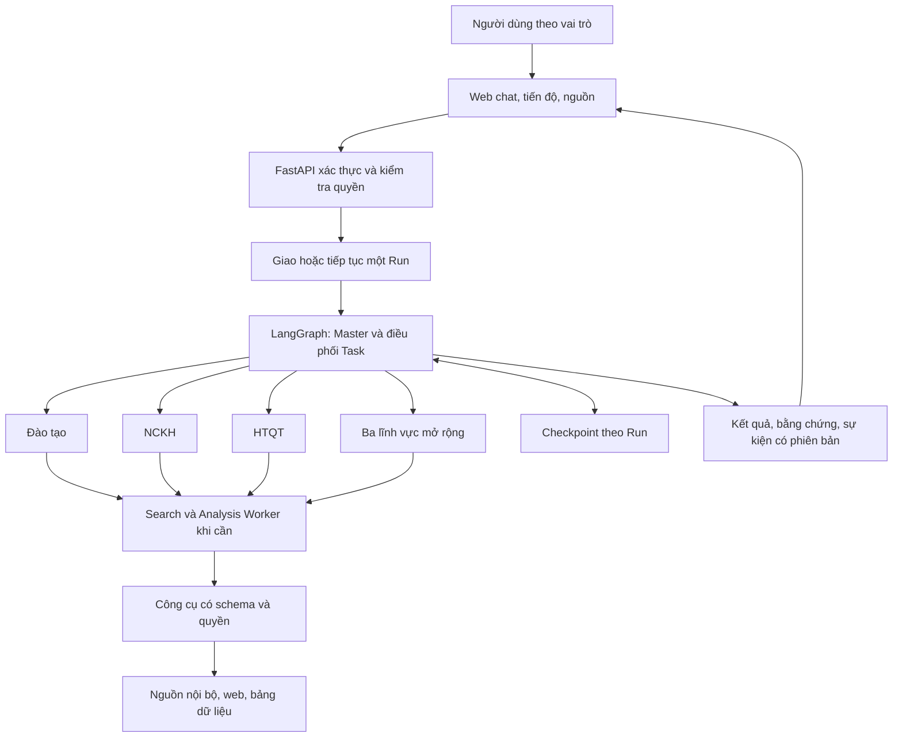

# Kế hoạch xây dựng Credere — phiên bản 2

Cập nhật: 23/09/2026 sau rà soát kỹ thuật. Chưa triển khai ứng dụng. Căn cứ và phân tích chi tiết tại [TECHNICAL_REVIEW.md](./TECHNICAL_REVIEW.md); bản đầu giữ tại [PLAN.v1.md](./PLAN.v1.md).

**Căn cứ.** Đã đọc toàn bộ [Bài toán.docx](./Bài%20toán.docx) và xem toàn bộ [ảnh mô hình phân cấp](./2aOboR0Rm398ong6dRyFudWSqCsv9pwaaPdoY5tg.jpg). Hai file mô tả yêu cầu, chưa cung cấp mã nguồn, kho dữ liệu nghiệp vụ, model/API hay hệ thống đăng nhập của trường. DOCX không chứa ảnh nhúng hoặc tệp đính kèm trong gói tài liệu.

**Mục tiêu.** Ứng dụng web tiếng Việt cho trường đại học, hỗ trợ hỏi đáp, tra cứu, phân tích và soạn báo cáo. Master lập kế hoạch, giao việc, kiểm tra và tổng hợp; Worker thực hiện chuyên môn trong phạm vi dữ liệu được cấp. Giữ đầy đủ yêu cầu FR1–FR4/NFR1–NFR3 trong DOCX và mở rộng theo mô hình sáu lĩnh vực trong ảnh.

Phân biệt ba mức: PoC chứng minh dữ liệu/model/cơ chế; MVP nghiệm thu ba lĩnh vực với phạm vi kiểm soát; pilot vận hành thử với người dùng và dữ liệu thực. Hoàn thiện đủ sáu lĩnh vực sau khi mỗi lĩnh vực có nguồn, quyền và tiêu chí chất lượng. PoC không được coi là MVP đã đạt tất cả yêu cầu.

**Các thay đổi chính so với bản đầu.** Thêm kiểm chứng dữ liệu và model trước khi dựng đầy đủ ứng dụng; giới hạn loại Task mà Master được lập; xác định một engine quản lý tiến trình trong Run; bỏ lựa chọn mặc định tự xây hàng đợi PostgreSQL; xác định Search/Analysis Worker có trace riêng; thêm bằng chứng cho từng nhận định và quyền của báo cáo phát sinh; đưa bộ đánh giá vào từ đầu; giảm giao diện giai đoạn đầu; bổ sung điều kiện môi trường và công sức dự kiến.

**Phạm vi Worker.**

| Tác tử | Nhiệm vụ, nguồn dữ liệu | Người dùng theo ảnh | Mức |
| --- | --- | --- | --- |
| Master / Supervisor | Tiếp nhận, phân rã, điều phối, đánh giá và tổng hợp liên lĩnh vực | Ban Giám hiệu | MVP |
| Đào tạo | Quy chế, chương trình, chuẩn đầu ra, tín chỉ, lịch thi; CSDL học vụ | Phòng Đào tạo, giảng viên, sinh viên | MVP |
| NCKH | Đề tài, công bố, quy định nghiên cứu, tài trợ; CSDL đề tài | Phòng NCKH, giảng viên | MVP |
| HTQT | Liên kết, học bổng, trao đổi, hợp tác nghiên cứu; văn bản HTQT, đối tác | Phòng HTQT, Ban Giám hiệu | MVP |
| Tuyển sinh | Chỉ tiêu, điểm chuẩn, ngành, học phí; CSDL tuyển sinh, thông báo | Phòng Tuyển sinh, thí sinh | Sau MVP |
| Nhân sự | Hợp đồng, lương, quy định, KPI; CSDL nhân sự | Phòng Tổ chức, Ban Giám hiệu | Sau MVP |
| Hành chính | Công văn, thủ tục, cơ sở vật chất; văn bản và quy trình | Toàn trường | Sau MVP |
| Search Worker hỗ trợ | Tìm/đọc nguồn, trích bằng chứng, trả nguồn có cấu trúc | Các Worker chuyên môn sử dụng trong quyền người yêu cầu | MVP |
| Analysis Worker hỗ trợ | Chuẩn hóa bảng, so sánh, gọi hàm tính; lưu đầu vào/công thức/kết quả | Các Worker chuyên môn sử dụng trong quyền người yêu cầu | MVP |

Hai Worker hỗ trợ đáp ứng cách gọi trong kịch bản nghiệm thu, không thay thế ba Worker chuyên môn. Worker là vai trò có context/công cụ riêng, không mặc định là một microservice hoặc một máy riêng. Mọi lời gọi hỗ trợ vẫn nằm trong DAG và giới hạn của Run, không tự sinh cây tác tử vô hạn.

Người dùng đơn vị dùng trợ lý chuyên môn được cấp; Supervisor có thể điều phối phía sau mọi phiên. Quyền báo cáo liên đơn vị cấp riêng. Xuất hiện trong cột người dùng không đồng nghĩa có quyền đọc toàn bộ dữ liệu lĩnh vực: sinh viên chỉ xem nguồn công khai và hồ sơ cá nhân được phép; nhân sự có phạm vi riêng theo bản ghi/hành động.

**Kiến trúc.** Một backend có module rõ ràng, một frontend, một CSDL. Cây trong ảnh biểu diễn chuyên môn/quyền. DAG của từng yêu cầu biểu diễn phụ thuộc công việc. Các lượt sửa hữu hạn nằm trong quy trình thực thi, không tạo chu trình của phụ thuộc nghiệp vụ.

Các Worker cũng có thể gọi trực tiếp công cụ đơn giản được cho phép; không bắt buộc qua Worker hỗ trợ cho mọi thao tác. Chỉ phân rã khi có lợi cho chuyên môn, nguồn hoặc kiểm chứng.

| Thành phần | Đề xuất |
| --- | --- |
| Frontend | React + TypeScript, ưu tiên giao diện chat/báo cáo rõ ràng. [Tài liệu React](https://react.dev/learn). |
| API | Python + FastAPI; Pydantic định nghĩa schema và kiểm tra dữ liệu. [Tài liệu FastAPI](https://fastapi.tiangolo.com/). |
| Điều phối | LangGraph là engine duy nhất quản lý Task, phụ thuộc và sửa nội dung trong Run. [Các mẫu workflow](https://docs.langchain.com/oss/python/langgraph/workflows-agents). |
| Trạng thái | Checkpointer lưu bền; hội thoại và kho tri thức có phạm vi riêng. [Tài liệu persistence](https://docs.langchain.com/oss/python/langgraph/persistence). |
| Lưu trữ/truy xuất | PostgreSQL và pgvector; so sánh từ khóa/embedding, dữ liệu nhỏ ưu tiên tìm chính xác. [Tài liệu pgvector](https://github.com/pgvector/pgvector). |
| Dispatch | PoC một executor; MVP dùng cơ chế lưu bền cấp Run. Phương án Linux là Celery + Redis, chỉ giao cả Run, không dựng DAG Celery thứ hai. |
| Tiến độ | SSE có event_id và khả năng đọc lại/kết nối lại; lịch sử sự kiện theo quyền |

Bảng Task/kết quả/sự kiện trong ứng dụng là bản phản chiếu có phiên bản của thực thi graph; không có scheduler thứ hai tự thay đổi tiến trình. Lưu kết quả theo run_id/task_id/attempt; có khóa chống hai executor cùng điều hành một Run. Quy tắc đồng bộ checkpoint, kết quả và sự kiện phải được thử bằng lỗi giả lập.

Không mặc định tự xây message queue từ PostgreSQL. Nếu chọn hướng đó để giảm số dịch vụ, cần đánh giá riêng claim nguyên tử, lease/heartbeat, retry, hàng lỗi và đối soát Run bị kẹt. BackgroundTasks trong API không thay thế yêu cầu hồi phục bền khi tiến trình dừng. [Tài liệu FastAPI về chạy nền](https://fastapi.tiangolo.com/tutorial/background-tasks/#caveat).

**Môi trường và model phải kiểm chứng ở mốc đầu.** Hiện máy có Windows 10 Pro, khoảng 63,8 GB RAM, CPU 18 lõi/36 luồng, Python 3.13 và Node 25.2.1; chưa tìm thấy docker/psql trong PATH. Đây là kiểm tra môi trường, chưa là benchmark khả năng phục vụ. Chuẩn hóa Node 24 LTS vì Node 25 đã EOL theo [lịch Node.js](https://nodejs.org/en/about/previous-releases). Thử dependency Python trong virtualenv trước khi khóa phiên bản. Celery cần Linux/WSL/container hoặc host Linux vì [không hỗ trợ Windows chính thức](https://docs.celeryq.dev/en/stable/faq.html#does-celery-support-windows).

MVP ưu tiên model qua API; không giả định khả năng chạy model lớn tại máy. Model Master/Worker cấu hình độc lập. Dùng baseline đủ chất lượng, thử Worker tiết kiệm hơn rồi so chi phí của Run đạt chất lượng, gồm cả retry. Nhà cung cấp phải được thử structured output, tool calling, tiếng Việt, lỗi/rate limit và giới hạn ngữ cảnh. Chưa chọn model/giá và chưa thay đổi môi trường trong bước lập kế hoạch.

**Hợp đồng dữ liệu.**

| Đối tượng | Trường chính |
| --- | --- |
| Run | run_id, user_id, conversation_id, goal, time_range, status, budget, plan_version |
| Task | task_id, run_id, worker_type, task_type, goal, context_refs, constraints, depends_on, acceptance_criteria, attempt, max_retries |
| WorkerResult | task_id, status, data, sources, evidence_refs, artifacts, error, usage, assumptions |
| Review | task_id, accepted, checks, feedback, required_changes, review_version |
| Source | source_id, title, url_or_document_id, published_at, effective_at, retrieved_at, locator, version, access_scope |
| Evidence | evidence_id, claim, source_id, supporting_excerpt, locator, time_range, units, access_scope |
| Event | event_id, run_id, task_id, event_type, timestamp, actor, payload_ref |

Danh tính và quyền do backend gắn từ phiên đăng nhập; kế hoạch LLM không được tự tăng quyền. Context dùng tham chiếu tới dữ liệu được phép, không sao chép toàn bộ tài liệu cho mọi Worker.

**Luồng thực thi.**

1. Xác thực, xác định phạm vi dữ liệu, tạo Run.
2. Master lập kế hoạch: câu hỏi đơn có một Task; yêu cầu tổng hợp có DAG nhỏ. task_type chỉ chọn từ danh mục tra cứu nội bộ, tìm nguồn, trích bằng chứng, tính toán, so sánh và soạn thảo.
3. Validator kiểm tra schema, ID, phụ thuộc tồn tại/không chu trình, năng lực Worker, công cụ, quyền và giới hạn. Kế hoạch sai phải sửa hoặc dừng.
4. Lưu kế hoạch trước Worker đầu tiên và hiển thị bản tóm tắt.
5. Graph chạy Task đã có phụ thuộc được chấp nhận; các Task độc lập chạy đồng thời trong hạn mức.
6. Worker trả dữ liệu, bằng chứng, lỗi và mức sử dụng. Search/Analysis có kết quả và trace riêng; không thực thi SQL hoặc mã tùy ý do model sinh.
7. Mã kiểm tra schema, đơn vị, phép tính, vị trí nguồn và ràng buộc. Master xem bằng chứng để đánh giá nội dung. URL tồn tại không đồng nghĩa nguồn hỗ trợ nhận định; nghiệm thu nội dung còn có người chuyên môn.
8. Sửa theo phản hồi cụ thể, tối đa hai lượt sửa mỗi Task, tức tối đa ba lần thực thi. Sửa phải bổ sung nguồn hoặc điều chỉnh dữ liệu/công thức có căn cứ.
9. Hết lượt hoặc chạm hạn mức: đánh dấu thất bại/một phần; chặn phụ thuộc không đủ điều kiện. Thiếu nguồn không được bịa để hoàn tất.
10. Tổng hợp kết quả được chấp nhận, kiểm tra dữ kiện và quyền người nhận, xuất bản một kết quả có phiên bản và lưu lịch sử.

Tham số thử nghiệm ban đầu: tối đa 8 Task nghiệp vụ/Run, 3 Task đồng thời và 20 lời gọi LLM toàn Run; tool call, retry mạng, thời gian và tiền có giới hạn riêng. Điều chỉnh sau PoC. Trần toàn Run ưu tiên hơn số lượt thử lại từng Task. Graph quản lý sửa nội dung; dispatch xử lý khởi động lại Run sau lỗi executor, tránh nhân nhiều vòng retry.

Có hủy và resume. Checkpoint không tự bảo đảm dịch vụ bên ngoài chỉ được gọi đúng một lần; sử dụng idempotency khi có hỗ trợ và ghi nhận phí của lần gọi lại. Hủy ngăn bước chưa chạy; request đã gửi có thể vẫn bị tính phí. Chi tiết bảo đảm thực thi phải được kiểm tra ở M2.

**Dữ liệu và quyền.** Tách checkpoint theo Run, hội thoại theo người dùng, kho tri thức có ACL. Trì hoãn bộ nhớ dài hạn do AI tự ghi. Bộ nhớ chung chỉ trong phạm vi Run và quyền người yêu cầu. Quyền áp dụng tại API, công cụ, truy vấn, tài liệu gốc, SSE, lịch sử, báo cáo và cache.

Luồng tài liệu: nhập → trích văn bản → kiểm tra chất lượng → chia đoạn → gắn lĩnh vực/nguồn/phiên bản/ngày hiệu lực/quyền → chỉ mục → truy xuất. MVP dùng PDF có văn bản, DOCX, TXT và CSV. OCR bổ sung khi dữ liệu cần, có kiểm tra chất lượng. DOCX dẫn mục/đoạn, PDF dẫn trang, web dẫn URL/thời điểm/bản trích. Lưu phiên bản model embedding; thử recall tiếng Việt và sau lọc quyền trước khi chọn cách đánh chỉ mục.

Báo cáo/cache lưu quan hệ tới nguồn đã dùng. Người nhận phải được phép xem dữ liệu làm căn cứ; nếu không, phải tạo lại từ tập được phép hoặc dùng quy tắc tổng hợp đã xác định. Kiểm tra lại quyền khi mở, resume, xuất kết quả hoặc sau thu hồi quyền. Tóm tắt không tự biến dữ liệu hạn chế thành công khai. Nội dung tài liệu/web không được thay đổi quyền hay công cụ.

RLS là lớp kiểm soát bổ sung tại CSDL. Runtime không dùng superuser/BYPASSRLS; xử lý đúng quyền chủ bảng và ngữ cảnh người dùng khi dùng connection pool. [Tài liệu PostgreSQL RLS](https://www.postgresql.org/docs/current/ddl-rowsecurity.html).

Các nhóm dữ liệu: users/roles/permissions; documents/versions/chunks/grants; conversations/messages; runs/tasks/attempts/results; sources/evidence/reviews/artifacts/events/usage_records. Migration có phiên bản. File runtime, CSDL và bí mật đặt ngoài vùng đồng bộ OneDrive; mã nguồn/tài liệu có thể ở credere.

**Giao diện theo thứ tự giá trị.**

| Khu vực | MVP |
| --- | --- |
| Hội thoại | Trợ lý được phép, yêu cầu, đính kèm, câu trả lời/nguồn; lỗi và trạng thái rõ |
| Tiến độ | Kế hoạch dạng danh sách, Task, phụ thuộc, Worker, trạng thái, lần sửa, hủy |
| Kho tài liệu | Upload, lĩnh vực, phiên bản, quyền, tình trạng xử lý |
| Báo cáo/lịch sử | Mở lại, xem bằng chứng, bảng so sánh/chi phí, xuất Markdown/CSV |
| Quản trị tối thiểu | Vai trò, cấu hình Worker/model, hạn mức và trace theo quyền |

Chat + tiến độ + nguồn được làm trước. Đồ thị tương tác, dashboard nâng cao và xuất DOCX/PDF sau khi luồng cốt lõi đạt chất lượng. Nền sáng, xanh đậm, thanh bên và bố cục đọc báo cáo là đề xuất; chưa có nhận diện thương hiệu đầu vào. Ưu tiên tiếng Việt, bàn phím, độ tương phản và responsive.

**Theo dõi và chi phí.** Ghi hành động, Worker, model/prompt phiên bản, nguồn, công cụ, kết quả, thời gian, token, quyết định nghiệm thu; che khóa bí mật/dữ liệu nhạy cảm và giới hạn người xem. Không yêu cầu lưu suy luận nội bộ của model.

Tính chi phí toàn Run từ từng model, tìm nguồn/công cụ và embedding; giá có ngày hiệu lực. Chi phí dịch vụ AI khác với ngân sách triển khai trong báo cáo nghiệp vụ. Chưa có đơn giá thì chỉ hiển thị mức sử dụng. Nhánh đồng thời đặt trước ngân sách dự kiến theo giới hạn token rồi quyết toán. Đo p50/p95, tỷ lệ lỗi/retry và chi phí Run đạt chất lượng trước khi chốt SLO/ngân sách.

**Các mốc sau điều chỉnh.**

| Mốc | Công việc | Điều kiện hoàn thành |
| --- | --- | --- |
| M-1 — PoC khả thi | Tập nguồn đại diện, 20 câu PoC, thử model/retrieval/bảng tính và môi trường; quyết định dispatch | Có số đo, bằng chứng cho case NCKH và hướng xử lý điểm yếu; đủ dữ liệu mới mở rộng |
| M0 — Nền tảng | Frontend/backend, schema, quyền, registry, cấu hình môi trường đã kiểm chứng | API hoạt động; schema/quyền thực thi được; dữ liệu mẫu có nhãn |
| M1 — Một luồng hoàn chỉnh | Master → NCKH → tìm nguồn/tính toán → đánh giá → báo cáo, UI tối thiểu | Kế hoạch có trước thực thi; bằng chứng và số liệu kiểm chứng được |
| M2 — Điều phối bền | Graph quản lý Task; dispatch cấp Run, phụ thuộc/song song, checkpoint, hạn mức, chống trùng, hủy/resume, SSE | Qua kiểm tra crash, timeout, đồng thời, kết nối lại và giới hạn; không xuất bản kết quả trùng |
| M3 — Ba lĩnh vực | Đào tạo, NCKH, HTQT; Search/Analysis hỗ trợ, dữ liệu/công cụ/rubric từng lĩnh vực | Đúng năng lực, nguồn, quyền và tính toán; có ca liên lĩnh vực |
| M4 — Web MVP | Hoàn thiện năm khu vực ở mức tối thiểu, lịch sử, xuất file, responsive | Trọn luồng theo từng vai trò và trạng thái lỗi |
| M5 — Nghiệm thu | Bộ đánh giá cố định, kịch bản đề bài, kiểm tra quyền/chi phí/hồi phục; tài liệu chạy | Đạt FR/NFR và tiêu chí bên dưới; có báo cáo kết quả thực tế |
| Pilot | Dữ liệu/tài khoản thật phạm vi hẹp, backup/phục hồi, theo dõi và xử lý phản hồi | Đầu mối nghiệp vụ xác nhận, vận hành và quyền đã được thử |
| M6 — Sáu lĩnh vực | Tuyển sinh, Nhân sự, Hành chính với dữ liệu/quyền/công cụ/test riêng | Đủ mô hình ảnh; thêm Worker qua registry, không thay logic lõi Master |

Cấu trúc dự kiến: frontend/; backend/app/api/; backend/app/orchestration/; backend/app/workers/; backend/app/tools/; backend/app/retrieval/; backend/app/auth/; backend/app/db/; tests/; evals/; docs/. Worker khai báo ID, năng lực, schema, model, công cụ, quyền cần dùng và tiêu chí.

**Kịch bản nghiệm thu NCKH.** Master xác định khoảng thời gian, chỉ số, tiêu chí chọn ba case và đơn vị chi phí. Đề xuất mặc định ba năm lịch hoàn tất gần nhất: tại ngày lập kế hoạch là 2023–2025; năm tới là 2027. Đây là giả định hiển thị rõ, cho phép đổi thành 36 tháng gần nhất hoặc mốc khác.

| Task | Nội dung | Phụ thuộc |
| --- | --- | --- |
| T0 | Master lập tiêu chí/thời gian/nguồn/phạm vi | Yêu cầu |
| T1 | NCKH giao Search tìm/đọc nguồn cho ba case và thu bằng chứng | T0 |
| T2 | Thu đầu vào triển khai/đơn giá/nhân lực; dùng Đào tạo/HTQT nếu phù hợp | T0; độc lập với T1 |
| T3 | NCKH giao Analysis chuẩn hóa chỉ số và bảng so sánh | T1 được chấp nhận |
| T4 | Lộ trình, khối lượng × đơn giá, một lần/định kỳ, giả định | T2 và T3 được chấp nhận |
| T5 | Master rà soát nguồn, số liệu, mâu thuẫn; sửa có giới hạn | T1–T4 |
| T6 | Báo cáo gồm kết quả, ba case, lộ trình, chi phí, hạn chế và nguồn | Đủ Task bắt buộc đạt |

Phân biệt năng suất, số lượng/chất lượng công bố và bằng chứng về tác động; quan sát tăng/giảm không tự chứng minh quan hệ nhân quả. Chi phí phải có nguồn hoặc ghi giả định. Thiếu ba case đủ bằng chứng thì báo thiếu, không đánh dấu đạt. Thêm ca liên lĩnh vực riêng; không ép mỗi câu hỏi gọi đủ mọi Worker.

**Tiêu chí kiểm tra.** PoC dùng 20 câu để tìm lỗi; chuẩn bị riêng bộ nghiệm thu 60 tình huống: 30 tra cứu (10/lĩnh vực), 10 tổng hợp/liên lĩnh vực, 10 thiếu dữ liệu và 10 sai quyền. Có nguồn/đáp án hoặc rubric, không dùng bộ nghiệm thu để chỉnh prompt rồi báo chất lượng.

| Yêu cầu | Cách kiểm tra |
| --- | --- |
| FR1 lập kế hoạch | Kế hoạch hợp lệ lưu trước sự kiện Worker đầu tiên |
| FR1 tuần tự/song song | Fixture chứng minh Task độc lập chồng thời gian; Task phụ thuộc đợi dữ liệu được chấp nhận |
| FR2 giao thức | Schema sai bị chặn; kết quả gắn đúng Task; kiểm tra quyền do backend |
| FR3 trạng thái | Crash/resume không trộn phiên, không mất kết quả đã lưu hoặc ghi đè kết quả song song |
| FR4 sửa lỗi | Tạo bảng sai/thiếu nguồn; phản hồi cụ thể, sửa có căn cứ, dừng đúng N lượt và hạn mức Run |
| NFR1 module hóa | Thêm Worker qua registry/module riêng mà không đổi lõi Master |
| NFR2 hiệu năng/chi phí | Model cấu hình riêng; đo chi phí của Run đạt chất lượng, tỷ lệ retry và tác động chạy song song |
| NFR3 trace | Báo cáo truy ngược tới Task, nguồn, bằng chứng, kết quả và quyết định nghiệm thu |
| Phân quyền | Cho phép/từ chối đúng tại API, nguồn, model payload, lịch sử, SSE, xuất file và sau thu hồi quyền |
| Giao diện | Đăng nhập → gửi → tiến độ → mở bằng chứng → lịch sử → xuất; kiểm tra lỗi/hủy |

Ngưỡng đề xuất: định tuyến đúng ít nhất 90% trong 40 ca có dữ liệu; bằng chứng cần thiết ở top 8 ít nhất 90% của 30 ca tra cứu; ít nhất 95% nhận định thực tế được kiểm tra có nguồn hỗ trợ; ít nhất 9/10 ca thiếu dữ liệu xử lý đúng; ít nhất 85% trong 40 ca có dữ liệu đạt rubric. Bộ test quyền không có rò rỉ; fixture tính toán đạt 100%; kịch bản ba case phải đạt đủ tiêu chí bắt buộc. Đây là ngưỡng chờ xác nhận với người nghiệm thu, chưa phải kết quả.

Đo p50/p95 trên tập cố định và thử 3 Run đồng thời; chốt SLO/chi phí sau PoC. Kiểm tra lỗi/scheduler bằng provider giả lập; chất lượng bằng model/nguồn thật và người chuyên môn. Lặp ca trọng yếu để thấy biến động; báo số mẫu và số lần chạy. Chi tiết trong TECHNICAL_REVIEW.md.

**Công sức và đầu vào.** Ước lượng sơ bộ với một kỹ sư có kinh nghiệm, nguồn/model sẵn có, người nghiệp vụ phản hồi và UI tiêu chuẩn: PoC 3–5 ngày công; thêm 20–35 ngày công cho MVP, tổng khoảng 5–8 tuần làm việc. Pilot thêm 10–20 ngày công. Chưa gồm tích hợp CSDL trường, SSO, OCR phức tạp hoặc chờ dữ liệu/hạ tầng; chưa đủ căn cứ ước lượng toàn trường. Đây không phải lịch cam kết.

M-1 cần model API, tập nguồn thật đại diện và ngân sách thử. Có thể thử cơ chế trên mẫu giả lập nhưng không kết luận chất lượng nghiệp vụ từ mẫu đó. M5 cần người xác nhận rubric và quyền dùng tài liệu. Pilot/M6 cần ma trận quyền chi tiết, nguồn/API, môi trường host, backup và người chịu trách nhiệm vận hành.

**Bàn giao.** Mã nguồn, cấu hình mẫu không có bí mật, migration, registry Worker/công cụ, dữ liệu demo có nhãn, bộ kiểm thử/đánh giá, báo cáo nghiệm thu và hướng dẫn chạy/triển khai. MVP hoàn thành ở M5; pilot và phạm vi sáu lĩnh vực có điều kiện bàn giao riêng như trên.
