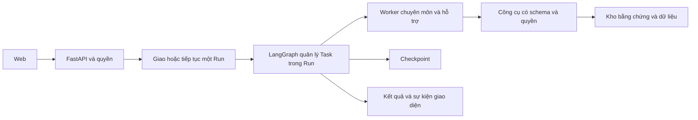

# Đánh giá kỹ thuật và tính khả thi của Credere

Ngày đánh giá: 23/09/2026. Căn cứ: Bài toán.docx, ảnh mô hình phân cấp, PLAN.md bản đầu, kiểm tra môi trường chỉ đọc và tài liệu kỹ thuật chính thức. Chưa có mã nguồn hoặc benchmark ứng dụng. Các ngưỡng và công sức bên dưới là đề xuất để kiểm chứng, không phải kết quả đã đạt.

Ghi chú 25/09/2026: phương án dispatch Celery + Redis và các lựa chọn công cụ trong tài liệu này đã được thay bằng [PLAN.md](./PLAN.md) bản 3 (Aegra, dự phòng Procrastinate, WSL2 + Docker) và [OSS_REVIEW.md](./OSS_REVIEW.md). Các nhận định còn lại vẫn giữ nguyên.

**Kết luận.** Khả thi để xây dựng MVP ba lĩnh vực có điều phối, truy xuất tài liệu, nguồn dẫn và báo cáo. Chưa có căn cứ cam kết vận hành toàn trường hoặc tự động tạo báo cáo luôn đúng. Nút thắt lớn nhất hiện tại là dữ liệu nghiệp vụ, tiêu chí đúng/sai và năng lực thực tế của model được chọn. Cần sửa kế hoạch trước khi triển khai để kiểm chứng những điểm đó sớm.

**Đầu vào thực sự yêu cầu gì.** DOCX bắt buộc Master lập kế hoạch, giao việc tuần tự/song song, giao thức chuẩn, bộ nhớ có quyền, vòng sửa hữu hạn, ba Worker chuyên môn, khả năng mở rộng, tối ưu chi phí và trace. Ảnh mở rộng thành sáu lĩnh vực với người dùng khác nhau. Giao diện năm khu vực, công nghệ cụ thể, tìm kiếm vector, hàng đợi tự xây và triển khai trên nhiều máy đều là lựa chọn thiết kế. Không nên coi toàn bộ lựa chọn này là khối lượng tối thiểu phải làm ngay.

Phân biệt ba mức bàn giao: PoC chứng minh kỹ thuật và dữ liệu; MVP đáp ứng đầy đủ yêu cầu cốt lõi trên phạm vi kiểm soát; pilot vận hành thử với tài khoản và dữ liệu thực. PoC không được trình bày như MVP đã đáp ứng đủ FR/NFR.

**Các điểm cần sửa trong kế hoạch đầu.**

| Ưu tiên | Vị trí | Điểm chưa rõ hoặc chưa hợp lý | Điều chỉnh |
| --- | --- | --- | --- |
| P0 | Các mốc triển khai | Làm nền tảng trước khi biết tài liệu/model có trả lời được bài toán | Thêm mốc kiểm chứng dữ liệu, retrieval, model và bảng tính trước M0 |
| P0 | Kiến trúc điều phối | LangGraph, scheduler và hàng đợi PostgreSQL chưa phân định trách nhiệm | Một engine quyết định tiến trình trong Run; bộ giao việc nền chỉ chuyển cả Run đến executor |
| P0 | Lập kế hoạch | DAG tự do có thể đúng schema nhưng sai nghiệp vụ | Master sinh kế hoạch trong danh mục loại Task cho phép; backend kiểm tra quyền, phụ thuộc và giới hạn |
| P0 | Kịch bản NCKH | Yêu cầu “tác động”, ba case và chi phí phụ thuộc bằng chứng chưa có | Định nghĩa chỉ số, cách chọn case, chất lượng bằng chứng và nguồn đơn giá; cho phép kết luận chưa đủ dữ liệu |
| P0 | Tự đánh giá | Reviewer LLM và số lượt sửa chưa đủ bảo đảm tính đúng | Kiểm tra bằng mã, đối chiếu bằng chứng và đánh giá chuyên môn; reviewer chỉ là một lớp hỗ trợ |
| P0 | Phân quyền | Chưa nói rõ quyền của báo cáo/kết quả phát sinh từ nhiều nguồn | Lưu nguồn gốc dữ liệu; người nhận phải được phép xem các bằng chứng được sử dụng |
| P1 | Công cụ tìm kiếm/tính toán | Việc đổi hai “Worker” trong tiêu chí đề thành công cụ có thể gây lệch kỳ vọng nghiệm thu | Đăng ký Search Worker và Analysis Worker hỗ trợ, có Task/kết quả/trace riêng; bên trong dùng công cụ cố định |
| P1 | Bộ nhớ | Dễ đồng nhất checkpoint, lịch sử, tri thức và trí nhớ liên phiên | Tách checkpoint theo Run, hội thoại theo người dùng và kho tri thức có ACL; trì hoãn bộ nhớ dài hạn do AI tự ghi |
| P1 | NFR2 | Giả định model nhỏ cho Worker luôn tiết kiệm | Đo chất lượng/chi phí trên bộ test; cấu hình riêng ngay từ đầu, giảm model sau khi đạt ngưỡng |
| P1 | Màn hình | Năm màn hình đầy đủ trước khi biết luồng cốt lõi có giá trị | Chat + tiến độ + nguồn trước; quản trị MVP tối thiểu, đồ thị tương tác nâng cao làm sau |
| P1 | Nghiệm thu | Định tính, chưa có mẫu kiểm thử và thước đo cụ thể | Bộ câu hỏi có đáp án/nguồn chuẩn, kiểm tra sai quyền, số liệu, lỗi mạng và hồi phục |
| P2 | Sáu lĩnh vực | Có nguy cơ hiểu thêm prompt đồng nghĩa hoàn thành chuyên môn | Mỗi lĩnh vực cần nguồn, chính sách quyền, công cụ và bộ đánh giá riêng |

**Kiến trúc nên dùng từ đầu.** Một backend gồm các module rõ ràng, một frontend, một CSDL. Worker là vai trò thực thi có cấu hình, context và công cụ riêng; không cần một máy hoặc microservice cho mỗi phòng ban. Ba Worker chuyên môn và hai Worker hỗ trợ có thể dùng chung một dịch vụ executor.

Master tạo một trong hai kiểu kế hoạch: câu hỏi đơn có một Task chuyên môn; yêu cầu tổng hợp có DAG nhỏ gồm Task thuộc các loại tra cứu nội bộ, tìm nguồn, trích xuất bằng chứng, tính toán, so sánh và soạn thảo. Backend xác minh kế hoạch rồi LangGraph điều hành. Vẫn lưu kế hoạch trước khi kích hoạt Worker như FR1. Không cho kế hoạch sinh mã thực thi, SQL tùy ý hoặc cấp thêm quyền.

LangGraph có các mẫu routing, parallelization, orchestrator-worker và evaluator-optimizer; chọn kết hợp có giới hạn là quyết định thiết kế phù hợp với bài toán này. [Tài liệu workflows và agents](https://docs.langchain.com/oss/python/langgraph/workflows-agents). Việc thêm tự chủ cần được đánh giá cùng độ trễ và chi phí. [Phân tích kiến trúc agent của Anthropic](https://www.anthropic.com/engineering/building-effective-agents).

Phân định trách nhiệm: LangGraph quản lý phụ thuộc, trạng thái Task và sửa nội dung; lớp dispatch quản lý giao/chạy lại một Run; CSDL ứng dụng lưu chỉ mục, bằng chứng, kết quả và sự kiện để tra cứu. Task/status trong ứng dụng là bản phản chiếu có phiên bản, không tự ra quyết định điều phối lần thứ hai. Kết quả lưu theo run_id, task_id, attempt để đối chiếu và tránh ghi đè.

PoC dùng một executor với checkpoint; người phát triển chủ động tiếp tục phiên sau gián đoạn. Trước nghiệm thu MVP về hồi phục tự động, cần dispatch lưu bền, khóa chống hai executor cùng chạy một Run, cơ chế đối soát Run bị kẹt và idempotency. Chọn thư viện hàng đợi sẵn có sau thử nghiệm môi trường; phương án cụ thể cho Linux là Celery + Redis. Celery chỉ giao cả Run, không dựng DAG thứ hai bằng chuỗi Task Celery. FastAPI cũng phân biệt BackgroundTasks đơn giản với các hệ thống chạy nền nhiều tiến trình. [Tài liệu FastAPI](https://fastapi.tiangolo.com/tutorial/background-tasks/#caveat).

Không mặc định xây message queue hoàn chỉnh từ PostgreSQL. Nếu vẫn chọn phương án đó để giảm dịch vụ, cần một quyết định thiết kế riêng về claim nguyên tử, lease/heartbeat, đối soát, retry, hàng lỗi và thử nghiệm crash. Đây là công việc thêm, không phải năng lực tự có khi tạo bảng runs.

Checkpoint là khả năng lưu trạng thái, không tự bảo đảm mọi lời gọi bên ngoài chỉ thực hiện một lần. Dùng checkpoint lưu bền thay vì chỉ RAM. [Tài liệu persistence](https://docs.langchain.com/oss/python/langgraph/persistence). Khi resume có thể phát sinh gọi lại; lưu dấu vết request, kết quả và khóa idempotency nếu nhà cung cấp hỗ trợ. Cơ chế ack/retry của hàng đợi cũng cần Task có tính idempotent. [Tài liệu Celery Tasks](https://docs.celeryq.dev/en/stable/userguide/tasks.html).

**Dữ liệu là mốc kiểm chứng đầu tiên.** Hai file hiện có là đặc tả, chưa phải kho tri thức. Trước khi đánh giá chất lượng cần một tập tài liệu đại diện có người phụ trách: đề xuất 20–40 tài liệu, có ít nhất một nguồn phù hợp từng lĩnh vực, một bảng số liệu và ba case NCKH đủ bằng chứng. Đây là quy mô mẫu để thử kỹ thuật, không phải bảo đảm phủ mọi nghiệp vụ. Nếu chưa có, đánh giá chỉ dùng nguồn công khai hoặc dữ liệu mẫu có nhãn.

Mỗi tài liệu có chủ sở hữu, lĩnh vực, ngày hiệu lực, phiên bản và phạm vi truy cập. Tài liệu scan cần kiểm tra lỗi OCR; DOCX dẫn theo mục/đoạn vì trang có thể đổi theo cách dàn trang; PDF dẫn trang; web lưu URL, thời điểm truy xuất và bản trích bằng chứng phù hợp. Với nguồn mâu thuẫn hoặc hết hiệu lực, phải nêu phiên bản đang dùng và lý do lựa chọn.

Bắt đầu bằng truy xuất có cấu trúc và từ khóa, thêm embedding để so sánh trên bộ câu hỏi tiếng Việt. Dùng tìm chính xác cho mã quy chế, tên chương trình và số quyết định. Lưu model/phiên bản/kích thước embedding để có kế hoạch đánh chỉ mục lại. Nếu thiếu bằng chứng thì dừng ở câu trả lời chưa đủ dữ liệu; tăng số agent không tự tạo ra dữ liệu còn thiếu.

ACL phải nằm trong truy vấn hoặc lớp công cụ trước khi dữ liệu được đưa vào model. Khi dùng chỉ mục vector gần đúng, cần đo lại khả năng tìm đủ tài liệu sau lọc quyền: pgvector ghi rõ bộ lọc có thể được áp dụng sau quét chỉ mục và làm giảm số kết quả. Bộ dữ liệu nhỏ có thể bắt đầu bằng tìm vector chính xác, chỉ thêm HNSW khi đo thấy cần. [Tài liệu filtering của pgvector](https://github.com/pgvector/pgvector#filtering).

**Tính đúng của AI cần nhiều lớp kiểm chứng.** JSON đúng chỉ chứng minh cấu trúc; link tồn tại chỉ chứng minh có nguồn. Để chứng minh một nhận định được nguồn hỗ trợ, cần đối tượng bằng chứng gồm claim, source_id, vị trí, đoạn hỗ trợ, ngày, đơn vị và phạm vi dữ liệu. Reviewer được xem bằng chứng này, không chỉ bản tóm tắt của Worker.

Kiểm tra bằng mã: schema, kiểu/đơn vị, tiền tệ, khoảng thời gian, phép cộng, công thức, số case khác nhau, trùng nguồn và các ràng buộc bắt buộc. Reviewer kiểm tra nội dung theo rubric. Người phụ trách nghiệp vụ xác nhận chất lượng trên bộ mẫu. Nghiên cứu về LLM-as-a-judge ghi nhận thiên lệch vị trí, độ dài và tự ưu ái; vì vậy điểm tự chấm không đủ làm bằng chứng nghiệm thu. [Nghiên cứu MT-Bench/Chatbot Arena](https://arxiv.org/abs/2306.05685).

Search Worker tìm và đọc nguồn; Analysis Worker gọi hàm tính có schema, dùng số thập phân cho tiền và lưu công thức. Không dùng Python/SQL do model sinh rồi chạy tự do trong MVP. Mỗi lần sửa phải thay đổi có căn cứ: tìm nguồn bổ sung, sửa dữ liệu đầu vào hoặc công thức. Lỗi thiếu dữ liệu không được xử lý chỉ bằng yêu cầu model viết lại.

Kịch bản NCKH phải phân biệt tăng số bài, chất lượng công bố, năng suất và hiệu quả chi phí. Quan sát trước/sau hoặc case kể lại chưa đủ chứng minh AI gây ra thay đổi. Báo cáo nêu mức độ bằng chứng và giới hạn so sánh. Chi phí kế hoạch năm sau dùng khối lượng, đơn giá có nguồn hoặc giả định rõ, thời điểm, tiền tệ và công thức; không suy ra chi phí của trường chỉ từ chi phí một tổ chức khác.

**Phân quyền là quan hệ người dùng–dữ liệu–hành động.** Cấp quản lý trong hình không tự là quyền đọc tất cả dữ liệu. Backend quyết định theo vai trò, đơn vị, chủ sở hữu hồ sơ và hành động. Master và các Worker hoạt động trong quyền người yêu cầu. Chỉ ẩn nút ở frontend hoặc ghi quyền trong prompt không đáp ứng yêu cầu.

Báo cáo/tóm tắt/cache kế thừa phạm vi từ các nguồn được sử dụng; nếu người nhận không được phép xem bằng chứng, phải tạo lại báo cáo trên tập được phép hoặc dùng quy tắc tổng hợp đã xác định. Khi thu hồi quyền tài liệu, phải kiểm tra lại quyền mở báo cáo và cache. Phạm vi quyền được kiểm tra cả lúc tạo Run, từng lần đọc nguồn, resume và xuất kết quả.

RLS là lớp bổ sung ở CSDL; cần cấu hình và kiểm thử đúng tài khoản kết nối, đặc biệt khi dùng pool. PostgreSQL ghi rõ superuser/BYPASSRLS và thông thường chủ bảng có thể bỏ qua RLS. [Tài liệu PostgreSQL](https://www.postgresql.org/docs/current/ddl-rowsecurity.html). MVP dùng dữ liệu công khai/giả lập cho kiểm tra vai trò; chỉ đưa dữ liệu thực vào pilot sau khi chính sách được xác nhận.

**Đánh giá môi trường thực tế.** Kiểm tra chỉ đọc ghi nhận Windows 10 Pro 64-bit, khoảng 63,8 GB RAM, Xeon E5-2686 v4 với 18 lõi/36 luồng, Python 3.13 và Node 25.2.1. Không tìm thấy docker và psql trong PATH; điều này không chứng minh chúng chưa được cài ở nơi khác. Chưa kiểm tra GPU, quyền ảo hóa, thông lượng mạng hoặc tương thích toàn bộ dependency.

Suy luận kỹ thuật: cấu hình CPU/RAM này hợp lý để phát triển web/API và thử tập tài liệu nhỏ khi LLM chạy qua API; chưa phải benchmark công suất người dùng. Không cần suy diễn rằng đủ khả năng chạy model lớn tại máy. Dùng API trước để đo chất lượng; chạy model tại chỗ chỉ được đánh giá riêng khi có yêu cầu dữ liệu và phần cứng cụ thể.

Nên chuẩn hóa Node 24 LTS cho dự án; Node 25 đang ở trạng thái EOL theo bảng phát hành hiện hành. [Lịch phát hành Node.js](https://nodejs.org/en/about/previous-releases). Python 3.13 đã có nhưng cần thử cài tập dependency trong virtualenv mới trước khi khóa phiên bản. Nếu chọn Celery, cần Linux/WSL/container hoặc máy Linux vì Celery không hỗ trợ Windows chính thức. [Celery FAQ](https://docs.celeryq.dev/en/stable/faq.html#does-celery-support-windows). Chưa cài đặt hay thay đổi môi trường trong lần đánh giá này.

CSDL, file runtime, virtualenv và bí mật nên đặt trong thư mục dữ liệu cục bộ ngoài vùng đồng bộ OneDrive; mã nguồn/tài liệu vẫn có thể nằm trong credere. Đây là khuyến nghị vận hành để tránh đồng bộ các file đang được ghi liên tục. Trước pilot cần môi trường host đã xác định, backup và thử phục hồi.

**Độ trễ và chi phí phải đo trên toàn Run.** Với k Worker chạy nối tiếp, thời gian gồm lập kế hoạch, tổng thời gian Worker, các lượt review/sửa và tổng hợp. Chạy song song chỉ rút ngắn các nhánh độc lập, không rút ngắn toàn bộ chuỗi và không bảo đảm giảm token.

Công thức lập ngân sách: C_run = tổng từng model [(input_tokens × giá_input + output_tokens × giá_output) / 1.000.000] + phí tìm nguồn/công cụ + chi phí embedding phân bổ. Tách thêm lưu trữ, hạ tầng và nhân công. Giá có ngày hiệu lực, cached token hoặc phí suy luận riêng được tính theo nhà cung cấp. Số Run/tháng × chi phí trung bình là ước tính khởi đầu; cần phân vị chi phí và tỷ lệ retry để dự phòng.

PoC ghi số lần gọi, token, lỗi, thời gian và chi phí cho từng bước. Thiết lập giới hạn thử nghiệm: tối đa 8 Task nghiệp vụ/Run, 3 Task đồng thời, tối đa 2 lượt sửa nội dung/Task và 20 lời gọi LLM toàn Run; tool call và retry mạng có trần riêng. Đây là tham số ban đầu để đo, có thể cần điều chỉnh. Trần toàn Run thắng trần từng Task: không bảo đảm mọi Task đều được thử đủ ba lần.

Khi chạy song song, đặt trước ngân sách dự kiến cho từng lời gọi theo giới hạn token rồi quyết toán sau; tránh tất cả nhánh cùng đọc một số dư và cùng chi vượt. Hủy có hiệu lực với bước chưa bắt đầu; request đã gửi có thể vẫn phát sinh phí. Tối ưu model nhỏ dựa trên chi phí của một Run đạt chất lượng, không chỉ giá/token.

**Bộ đánh giá đề xuất, chưa có kết quả.** PoC dùng 20 câu đại diện để phát hiện điểm hỏng. Sau đó chuẩn bị riêng 60 tình huống nghiệm thu: 30 tra cứu (10/lĩnh vực), 10 tổng hợp/liên lĩnh vực, 10 thiếu thông tin và 10 sai quyền. Có đáp án/rubric, nguồn chuẩn và đánh dấu dữ liệu được phép; không dùng bộ nghiệm thu để chỉnh prompt rồi tự báo chất lượng.

| Hạng mục | Ngưỡng thử nghiệm đề xuất |
| --- | --- |
| Kế hoạch và schema | Mọi kế hoạch được thực thi đều qua validator; raw output lỗi phải sửa hoặc dừng, không được chạy lách kiểm tra |
| Định tuyến | Ít nhất 90% trong 40 tình huống có dữ liệu chọn đúng lĩnh vực/năng lực theo nhãn chuẩn |
| Truy xuất | Ít nhất 90% trong 30 câu tra cứu có bằng chứng cần thiết trong top 8 đoạn được phép |
| Nguồn hỗ trợ | Ít nhất 95% nhận định thực tế được kiểm tra có nguồn hỗ trợ đúng; số liệu quan trọng trong báo cáo mẫu kiểm tra toàn bộ |
| Thiếu dữ liệu | Ít nhất 9/10 tình huống nhận diện đúng thiếu thông tin; không bịa số để hoàn tất |
| Quyền | Không có rò rỉ trong toàn bộ ca kiểm thử quyền, kể cả payload gửi model; đây là điều kiện chặn nghiệm thu, không phải chứng minh tuyệt đối an toàn |
| Tính toán | 100% bộ fixture phép tính đúng, khớp đơn vị và quy tắc làm tròn |
| Báo cáo | Ít nhất 85% trong 40 tình huống có dữ liệu đạt rubric chuyên môn; kịch bản ba case trong đề phải đạt đầy đủ các điều kiện bắt buộc |
| Hồi phục | Mô phỏng dừng executor, gọi API timeout, kết nối SSE lại; không trộn phiên, không xuất bản kết quả trùng, dừng đúng hạn mức |
| Độ trễ và chi phí | Đo p50/p95 trên tập tác vụ cố định, thử đồng thời 3 Run; chốt ngân sách/SLO sau PoC dựa trên model và nguồn thật |

Lặp lại các ca trọng yếu nhiều lần để thấy độ biến động; báo rõ số mẫu và số lần chạy. Các ngưỡng là tiêu chí ban đầu cần thống nhất với người nghiệm thu, không phải chuẩn phổ quát hoặc cam kết đạt trên mọi câu hỏi.

**Ước lượng công sức có điều kiện.** Giả định một kỹ sư đã có kinh nghiệm full-stack/Python, một người nghiệp vụ phản hồi hằng tuần, dùng model API, dữ liệu đại diện và quyền truy cập sẵn có, giao diện tiêu chuẩn, chưa tích hợp CSDL trường/SSO và chưa xử lý OCR phức tạp.

| Mức | Công sức ước tính | Đầu ra |
| --- | --- | --- |
| PoC kiểm chứng | 3–5 ngày công | Dữ liệu mẫu đại diện, baseline, bằng chứng, số liệu chất lượng/chi phí, quyết định kiến trúc |
| MVP sau PoC | Thêm 20–35 ngày công | Ba lĩnh vực, Worker hỗ trợ, điều phối, quyền, web tối thiểu, nguồn và kiểm thử cốt lõi |
| Pilot sau MVP | Thêm 10–20 ngày công | Tài khoản/dữ liệu thực phạm vi hẹp, làm chắc vận hành, backup, theo dõi và sửa lỗi thực tế |
| Toàn trường/sáu lĩnh vực | Chưa đủ cơ sở ước lượng | Phụ thuộc schema/API, dữ liệu, vai trò, tải, SSO và yêu cầu vận hành |

Tổng PoC + MVP tương đương khoảng 5–8 tuần làm việc của một kỹ sư theo giả định trên. Đây là ước lượng kỹ thuật sơ bộ, không phải lịch đã cam kết. Thời gian chờ dữ liệu, tài khoản, hạ tầng và phản hồi làm tăng lịch thực tế. Sinh viên mới làm hoặc nhóm chưa có kinh nghiệm LLM cần dự phòng lớn hơn; hiện chưa có căn cứ định lượng.

**Điều kiện quyết định tiếp tục.** Tiến hành PoC khi có model và ít nhất một tập nguồn thật phù hợp. Bắt đầu triển khai MVP khi đã đo được truy xuất, chất lượng trả lời và bằng chứng NCKH; nếu không đạt thì sửa dữ liệu/cách truy xuất/phạm vi trước khi tăng số Worker. Nghiệm thu MVP sau khi đủ FR1–FR4/NFR1–NFR3 và kiểm tra quyền. Mở pilot sau khi dữ liệu thực, hạ tầng và người chịu trách nhiệm nghiệp vụ đã xác định. Mở thêm lĩnh vực chỉ khi lĩnh vực đó có nguồn, quyền và bộ đánh giá riêng.
